## Uso de Agentes IA para análisis de datos e investigación {#inicio bento-variant="hero"}

::: {#inicio-kicker bento-slot="kicker"}

SOCIEDAD PERUANA DE PSICOMETRÍA · TALLER VIRTUAL

:::

::: {#inicio-visual bento-slot="visual"}

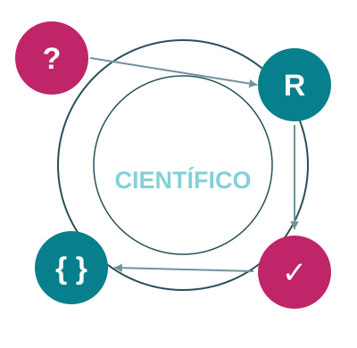

:::

::: {#inicio-subtitle bento-slot="subtitle"}

Una introducción al trabajo con agentes, con aplicaciones al análisis psicométrico.

:::

::: {#inicio-citation bento-slot="citation"}

Brian Norman Peña Calero · 3 horas · R como motor de ejecución

:::

::: {#inicio-notas .notes}
Conservar el título anunciado. Presentar carácter introductorio, independencia del agente y foco psicométrico. No prometer investigación autónoma ni una validación completa de instrumentos.
:::

## Cinco respuestas, una decisión {#promesa bento-variant="visual"}

::: {#promesa-kicker bento-slot="kicker"}

APERTURA · ANTICIPAR

:::

::: {#promesa-visual bento-slot="visual"}

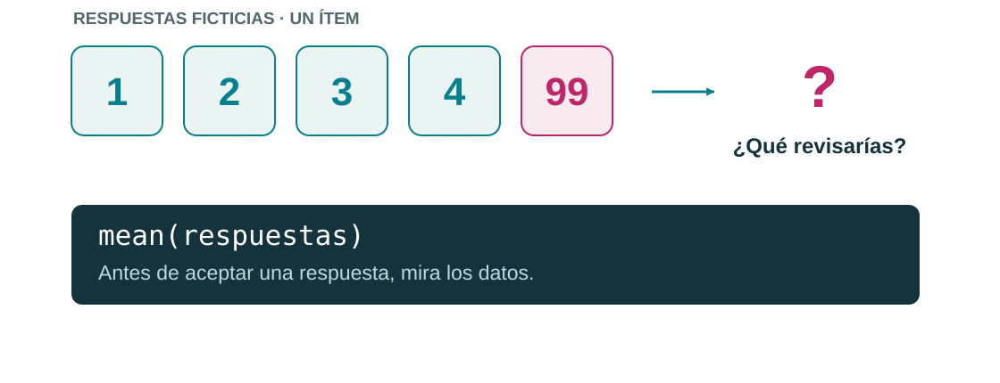

:::

::: {#promesa-takeaway bento-slot="takeaway"}

¿Qué falta saber antes de aceptar el resultado?

:::

::: {#promesa-citation bento-slot="citation"}

Microejemplo ficticio · R 4.6.1 · materiales/microcaso/01_microcaso.R

:::

::: {#promesa-notas .notes}
Pedir al grupo que anticipe qué información revisaría antes de aceptar la media. No revelar todavía que 99 representa un perdido. Mantener fijo el vector durante los estados siguientes.
:::

## Una ejecución sin errores {#micro-ejecucion bento-variant="visual"}

::: {#micro-ejecucion-kicker bento-slot="kicker"}

APERTURA · OBSERVAR

:::

::: {#micro-ejecucion-visual bento-slot="visual"}


:::

::: {#micro-ejecucion-takeaway bento-slot="takeaway"}

El código funciona; el análisis puede seguir estando mal.

:::

::: {#micro-ejecucion-citation bento-slot="citation"}

Microejemplo ficticio · R 4.6.1 · materiales/microcaso/01_microcaso.R

:::

::: {#micro-ejecucion-notas .notes}
Mostrar que R efectivamente ejecutó el código y devolvió 21.8. Es una interpretación errónea preparada, no un fallo atribuido a un agente. Si las respuestas válidas van de 1 a 4, el resultado exige revisar el diccionario.
:::

## La ruta del taller {#tres-preguntas bento-variant="visual"}

::: {#tres-preguntas-kicker bento-slot="kicker"}

APERTURA · ORIENTARSE

:::

::: {#tres-preguntas-visual bento-slot="visual"}

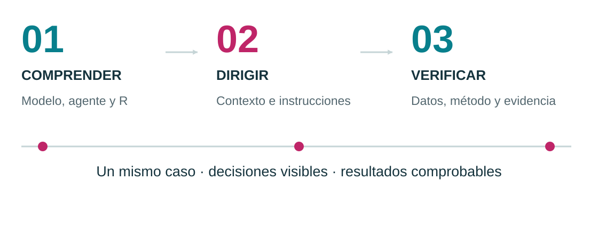

:::

::: {#tres-preguntas-takeaway bento-slot="takeaway"}

Un método transferible; un caso psicométrico para aprenderlo.

:::

::: {#tres-preguntas-citation bento-slot="citation"}

Esquema didáctico · no son resultados observados.

:::

::: {#tres-preguntas-notas .notes}
Enlazar el error con tres preguntas: comprender, dirigir y verificar. Presentar el mismo microejemplo como hilo que regresará en contexto, auditoría y reproducción. El caso factorial amplía esas decisiones sin inventar resultados.
:::

## Punto de partida {#sondeo-inicial bento-variant="question"}

::: {#sondeo-inicial-kicker bento-slot="kicker"}

APERTURA · PARTICIPAR

:::

::: {#sondeo-inicial-question bento-slot="question"}

¿Hasta dónde has trabajado con IA?

:::

::: {#sondeo-inicial-prompt bento-slot="prompt"}

En el chat: 1 = conversación; 2 = código sugerido; 3 = herramientas; 4 = análisis ejecutado.

:::

::: {#sondeo-inicial-notas .notes}
Sondeo de 90 segundos. No confundir experiencia con IA con formación estadística. Usar las respuestas para graduar la explicación, no como evaluación.
:::

## Generación condicionada por el contexto {#modelo-probabilistico bento-variant="visual"}

::: {#modelo-probabilistico-kicker bento-slot="kicker"}

01 / COMPRENDER

:::

::: {#modelo-probabilistico-visual bento-slot="visual"}

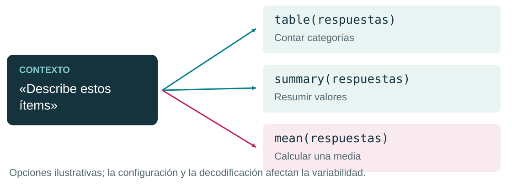

:::

::: {#modelo-probabilistico-takeaway bento-slot="takeaway"}

El modelo es probabilístico; una respuesta plausible no prueba que sea correcta.

:::

::: {#modelo-probabilistico-citation bento-slot="citation"}

Esquema didáctico · no son resultados observados.

:::

::: {#modelo-probabilistico-notas .notes}
Explicar primero con un encargo familiar: describir respuestas. Las continuaciones son ilustrativas y no probabilidades medidas. Un LLM modela distribuciones; la decodificación puede reducir variabilidad. Probabilístico no significa que todo resultado cambie siempre. Una propuesta plausible no es una decisión estadística validada.
:::

## Proponer, ejecutar y verificar {#generar-ejecutar bento-variant="visual"}

::: {#generar-ejecutar-kicker bento-slot="kicker"}

01 / COMPRENDER

:::

::: {#generar-ejecutar-visual bento-slot="visual"}


:::

::: {#generar-ejecutar-takeaway bento-slot="takeaway"}

No pedir números al modelo cuando podemos obtenerlos de una ejecución.

:::

::: {#generar-ejecutar-citation bento-slot="citation"}

Esquema didáctico · no son resultados observados.

:::

::: {#generar-ejecutar-notas .notes}
Separar tres operaciones que suelen mezclarse. El modelo propone código, R produce salidas y la persona revisa pertinencia y conclusiones. El retorno representa la corrección iterativa, no autonomía irrestricta.
:::

## Dos recorridos para una misma tarea {#chatbot-agente bento-variant="visual"}

::: {#chatbot-agente-kicker bento-slot="kicker"}

01 / COMPRENDER

:::

::: {#chatbot-agente-visual bento-slot="visual"}

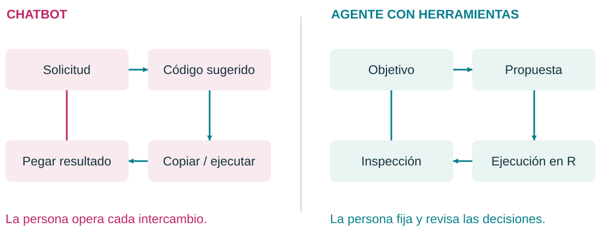

:::

::: {#chatbot-agente-takeaway bento-slot="takeaway"}

Automatizar intercambios no transfiere la responsabilidad.

:::

::: {#chatbot-agente-citation bento-slot="citation"}

Esquema didáctico · no son resultados observados.

:::

::: {#chatbot-agente-notas .notes}
Contraste controlado: misma pregunta y mismo R. A la izquierda la persona hace el intercambio manual; a la derecha el agente opera herramientas. Preguntar qué cambia y qué permanece. La responsabilidad científica permanece.
:::

## La anatomía de un agente {#anatomia-agente bento-variant="visual"}

::: {#anatomia-agente-kicker bento-slot="kicker"}

01 / COMPRENDER

:::

::: {#anatomia-agente-visual bento-slot="visual"}

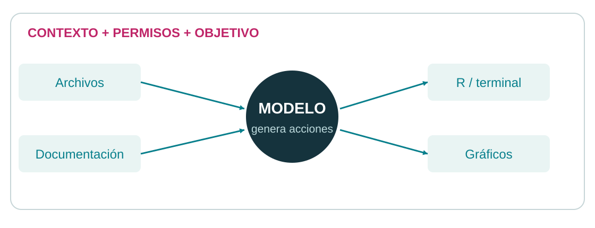

:::

::: {#anatomia-agente-takeaway bento-slot="takeaway"}

Modelo + herramientas + contexto + controles.

:::

::: {#anatomia-agente-citation bento-slot="citation"}

Esquema didáctico · no son resultados observados.

:::

::: {#anatomia-agente-notas .notes}
Definir herramienta por su función: leer archivos, ejecutar R o inspeccionar una figura. Contexto, permisos y objetivo limitan el proceso. No presentar un agente como un modelo más inteligente por definición.
:::

## Aleatoriedad bajo control {#r-reproducible bento-variant="comparison"}

::: {#r-reproducible-kicker bento-slot="kicker"}

01 / COMPRENDER

:::

::: {#r-reproducible-left-label bento-slot="left-label"}

Mismo punto de partida

:::

::: {#r-reproducible-left bento-slot="left" .bento-code}

```{#r-reproducible-left-source .r}
set.seed(2026)
sample(1:100, size = 5)
```

:::

::: {#r-reproducible-right-label bento-slot="right-label"}

Qué debemos conservar

:::

::: {#r-reproducible-right bento-slot="right"}

La semilla, el generador, la versión de R, los datos y las decisiones de cálculo.  
Una semilla no resuelve todos los problemas de reproducibilidad.

:::

::: {#r-reproducible-takeaway bento-slot="takeaway"}

Ejecución controlada y reproducible, no determinismo absoluto.

:::

::: {#r-reproducible-citation bento-slot="citation"}

R Core: documentación de set.seed y RNGversion.

:::

::: {#r-reproducible-notas .notes}
Ejecutar opcionalmente dos veces la misma llamada tras reiniciar la semilla. No mostrar una lista de números que no haya sido calculada. La lección es que R puede contener aleatoriedad controlada y que reproducibilidad no equivale a determinismo absoluto.
:::

## Tres preguntas de verificación {#niveles-de-verificacion bento-variant="visual"}

::: {#niveles-de-verificacion-kicker bento-slot="kicker"}

01 / COMPRENDER

:::

::: {#niveles-de-verificacion-visual bento-slot="visual"}

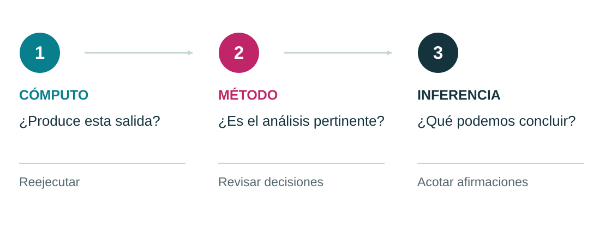

:::

::: {#niveles-de-verificacion-takeaway bento-slot="takeaway"}

Superar una comprobación no implica superar las otras.

:::

::: {#niveles-de-verificacion-citation bento-slot="citation"}

Esquema didáctico · no son resultados observados.

:::

::: {#niveles-de-verificacion-notas .notes}
Volver al 21.8: pasó la ejecución, no la lectura metodológica de los datos. Que un script reproduzca un error no lo hace correcto. Hacer explícito qué evidencia responde cada pregunta.
:::

## Cuatro capas diferentes {#ecosistema-capas bento-variant="visual"}

::: {#ecosistema-capas-kicker bento-slot="kicker"}

02 / HERRAMIENTAS

:::

::: {#ecosistema-capas-visual bento-slot="visual"}

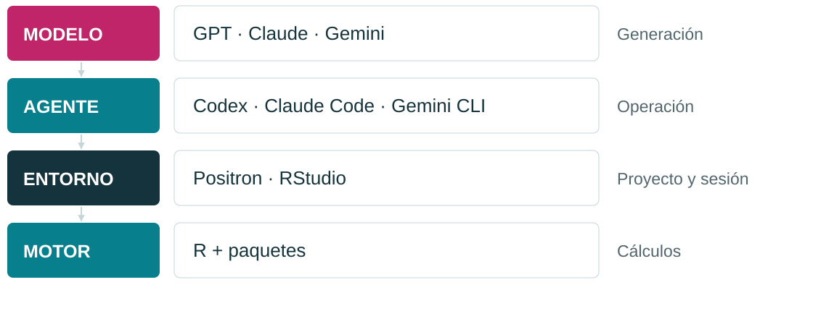

:::

::: {#ecosistema-capas-takeaway bento-slot="takeaway"}

No confundir el modelo con el programa que opera las herramientas.

:::

::: {#ecosistema-capas-citation bento-slot="citation"}

Documentación oficial: Codex, Claude Code, Gemini CLI y Posit. Referencias al final.

:::

::: {#ecosistema-capas-notas .notes}
Nombrar modelo, agente, entorno y motor. La selección no es una competición de marcas. Aclarar que las herramientas evolucionan y que no todos los agentes cargan las mismas instrucciones o conectores.
:::

## Agentes: elegir una vía de trabajo {#opciones-agentes bento-variant="summary"}

::: {#opciones-agentes-kicker bento-slot="kicker"}

02 / HERRAMIENTAS

:::

::: {#opciones-agentes-first bento-slot="first"}

Codex · Claude Code · Gemini CLI

:::

::: {#opciones-agentes-second bento-slot="second"}

Agentes externos que trabajan sobre archivos y herramientas.

:::

::: {#opciones-agentes-third bento-slot="third"}

Posit Assistant: una vía integrada en Positron o RStudio.

:::

::: {#opciones-agentes-fourth bento-slot="fourth"}

Para la sesión: un agente preparado, no cuatro instalaciones.

:::

::: {#opciones-agentes-citation bento-slot="citation"}

Fuentes oficiales de OpenAI, Anthropic, Google y Posit; consultadas el 29-10-2026.

:::

::: {#opciones-agentes-notas .notes}
Explicar las tres familias externas y la opción integrada. Mencionar otras alternativas solo si surge en preguntas. No prometer equivalencia de permisos, skills, plataformas o MCP. No convertir esta diapositiva en tabla de precios.
:::

## Positron por dentro {#positron-entorno bento-variant="screenshot"}

::: {#positron-entorno-kicker bento-slot="kicker"}

02 / HERRAMIENTAS · CAPTURA PROPIA

:::

::: {#positron-entorno-visual bento-slot="visual"}


:::

::: {#positron-entorno-side1 bento-slot="side1"}

**1 · Script.** Instrucciones que podemos leer y modificar.

:::

::: {#positron-entorno-side2 bento-slot="side2"}

**2 · Consola R.** Lugar donde se ejecutan los cálculos.

:::

::: {#positron-entorno-side3 bento-slot="side3"}

**3 · Salida.** Evidencia que debe coincidir con lo reportado.

:::

::: {#positron-entorno-takeaway bento-slot="takeaway"}

No basta con la respuesta del chat: observa dónde se ejecuta.

:::

::: {#positron-entorno-citation bento-slot="citation"}

Captura propia · Positron 2026.10.2 · R 4.6.1 · microejemplo sintético.

:::

::: {#positron-entorno-notas .notes}
Mostrar la ventana real en perfil aislado, sin cuentas ni credenciales. No se utilizó un agente para producir esta captura: se ejecutó el script docente en R. El fin es localizar las superficies, no leer todo el código a esta escala.
:::

## MCP: el puente hacia R {#positron-mcp bento-variant="visual"}

::: {#positron-mcp-kicker bento-slot="kicker"}

02 / HERRAMIENTAS

:::

::: {#positron-mcp-visual bento-slot="visual"}

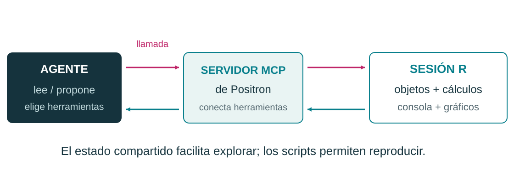

:::

::: {#positron-mcp-takeaway bento-slot="takeaway"}

Sesión compartida para explorar; archivos para reproducir.

:::

::: {#positron-mcp-citation bento-slot="citation"}

Posit: October Release Highlights, 13-10-2026. Funcionalidad experimental.

:::

::: {#positron-mcp-notas .notes}
Definir Model Context Protocol una sola vez. Es un mecanismo para conectar herramientas. Positron 2026.10 incorporó un servidor MCP experimental; verificar agente y versión. El puente puede acceder a la sesión persistente, no sustituye los scripts.
:::

## Una llamada visible a una herramienta {#mcp-captura bento-variant="screenshot"}

::: {#mcp-captura-kicker bento-slot="kicker"}

02 / HERRAMIENTAS · CAPTURA OFICIAL

:::

::: {#mcp-captura-visual bento-slot="visual"}

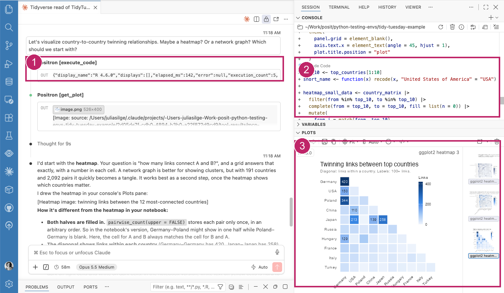

:::

::: {#mcp-captura-side1 bento-slot="side1"}

**1 · Solicitud.** El agente llama a una herramienta de Positron.

:::

::: {#mcp-captura-side2 bento-slot="side2"}

**2 · Ejecución.** La consola identifica el código del agente.

:::

::: {#mcp-captura-side3 bento-slot="side3"}

**3 · Resultado.** Un gráfico observable, no solo una descripción.

:::

::: {#mcp-captura-takeaway bento-slot="takeaway"}

La llamada y la salida dejan rastros que podemos inspeccionar.

:::

::: {#mcp-captura-citation bento-slot="citation"}

Posit (13-10-2026) · captura oficial de producto · fuente y original en assets/screenshots/

:::

::: {#mcp-captura-notas .notes}
Se trata de una captura publicada por Posit, con otro conjunto de datos. No presentarla como una ejecución del taller. Señalar las tres regiones; la siguiente lámina amplía dos detalles para que se puedan leer.
:::

## Del pedido a la consola {#mcp-detalle bento-variant="comparison"}

::: {#mcp-detalle-kicker bento-slot="kicker"}

02 / HERRAMIENTAS · AMPLIACIÓN

:::

::: {#mcp-detalle-left-label bento-slot="left-label"}

Detalle 1 · llamada de herramienta

:::

::: {#mcp-detalle-left bento-slot="left"}


:::

::: {#mcp-detalle-right-label bento-slot="right-label"}

Detalle 2 · código en la sesión R

:::

::: {#mcp-detalle-right bento-slot="right"}

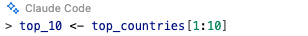

:::

::: {#mcp-detalle-takeaway bento-slot="takeaway"}

La conexión debe probarse con el agente y la versión elegidos.

:::

::: {#mcp-detalle-citation bento-slot="citation"}

Posit (2026) · recortes de claude-code-in-positron.png; original conservado.

:::

::: {#mcp-detalle-notas .notes}
Mantener los píxeles de la captura original y ampliar dos regiones. Preguntar dónde buscaríamos un error de ejecución. No leer nombres de modelos de la interfaz como requisito para el curso.
:::

## Posit Assistant: otra forma de entrar {#posit-assistant bento-variant="screenshot"}

::: {#posit-assistant-kicker bento-slot="kicker"}

02 / HERRAMIENTAS · CAPTURA OFICIAL

:::

::: {#posit-assistant-visual bento-slot="visual"}

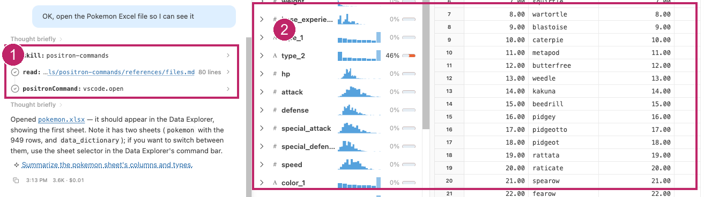

:::

::: {#posit-assistant-side1 bento-slot="side1"}

**Pedir.** Formular una tarea dentro del entorno.

:::

::: {#posit-assistant-side2 bento-slot="side2"}

**Inspeccionar.** Observar las instrucciones y herramientas utilizadas.

:::

::: {#posit-assistant-side3 bento-slot="side3"}

**Comprobar.** Revisar el objeto abierto y el resultado.

:::

::: {#posit-assistant-takeaway bento-slot="takeaway"}

Un proveedor configurado; ningún secreto en las diapositivas.

:::

::: {#posit-assistant-citation bento-slot="citation"}

Posit (13-10-2026) · captura oficial de producto · fuente y original en assets/screenshots/

:::

::: {#posit-assistant-notas .notes}
Captura oficial con un archivo de ejemplo ajeno al taller. Mostrar la secuencia skill, referencia, comando y resultado. Indicar disponibilidad en Positron y RStudio; el acceso requiere un proveedor configurado. No suponer que una suscripción de chat equivale a cualquier acceso API.
:::

## Un nuevo analista en el equipo {#analista-equipo bento-variant="section"}

::: {#analista-equipo-kicker bento-slot="kicker"}

03 / CONTEXTUALIZAR

:::

::: {#analista-equipo-number bento-slot="number"}

03

:::

::: {#analista-equipo-subtitle bento-slot="subtitle"}

Antes de pedir código: explicar el estudio, los datos y la forma de trabajar.

:::

::: {#analista-equipo-notas .notes}
Usar la analogía propuesta por Brian. Preguntar qué información necesitaría una persona competente recién incorporada. No empezar por ingeniería de prompts.
:::

## El contexto que falta {#onboarding bento-variant="visual"}

::: {#onboarding-kicker bento-slot="kicker"}

03 / CONTEXTUALIZAR

:::

::: {#onboarding-visual bento-slot="visual"}

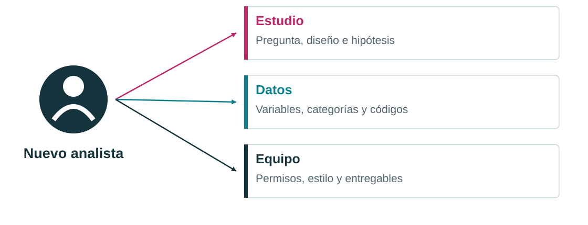

:::

::: {#onboarding-takeaway bento-slot="takeaway"}

Saber estadística no equivale a conocer este proyecto.

:::

::: {#onboarding-citation bento-slot="citation"}

Esquema didáctico · no son resultados observados.

:::

::: {#onboarding-notas .notes}
Diferenciar conocimiento general de investigación de contexto específico del estudio. Un analista experimentado tampoco sabe por defecto qué significa 99 o cuál es la hipótesis factorial.
:::

## Un mapa, no un documento gigante {#documentos bento-variant="visual"}

::: {#documentos-kicker bento-slot="kicker"}

03 / CONTEXTUALIZAR

:::

::: {#documentos-visual bento-slot="visual"}

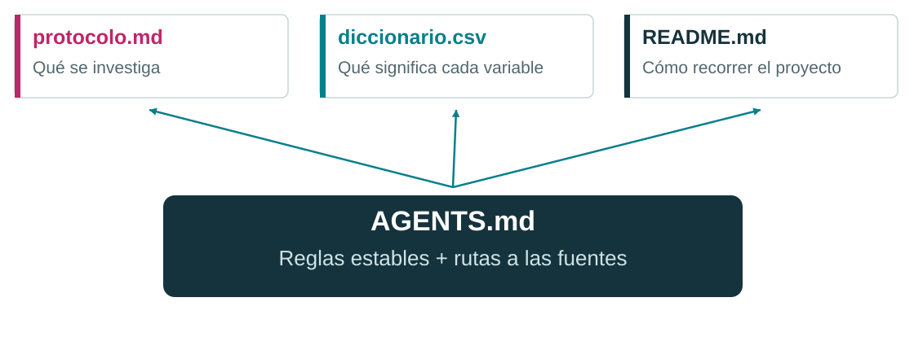

:::

::: {#documentos-takeaway bento-slot="takeaway"}

Una fuente por decisión; referencias claras entre documentos.

:::

::: {#documentos-citation bento-slot="citation"}

Convención AGENTS.md + plantilla docente en materiales/plantilla-proyecto/.

:::

::: {#documentos-notas .notes}
Recorrer las tres fuentes: protocolo, diccionario y README. AGENTS.md contiene reglas persistentes y rutas; no absorbe todos los documentos. La metodología pertenece al estudio y debe ser legible también sin un agente.
:::

## ¿Dónde guardarías cada información? {#clasificar-actividad bento-variant="question"}

::: {#clasificar-actividad-kicker bento-slot="kicker"}

03 / CONTEXTUALIZAR · ANTICIPAR

:::

::: {#clasificar-actividad-question bento-slot="question"}

«99 = perdido»  
«No sobrescribir originales»

:::

::: {#clasificar-actividad-prompt bento-slot="prompt"}

¿Van en el mismo archivo? Responde y justifica antes de avanzar.

:::

::: {#clasificar-actividad-notas .notes}
Pausa de dos minutos. Buscar la diferencia entre significado de los datos y regla de trabajo. No convertir la organización documental en ritual.
:::

## Información y lugar apropiado {#clasificar-respuesta bento-variant="visual"}

::: {#clasificar-respuesta-kicker bento-slot="kicker"}

03 / CONTEXTUALIZAR · RESOLVER

:::

::: {#clasificar-respuesta-visual bento-slot="visual"}

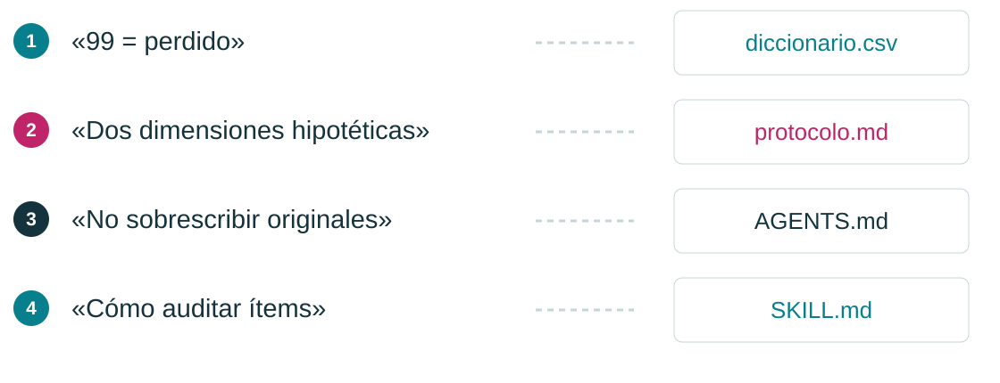

:::

::: {#clasificar-respuesta-takeaway bento-slot="takeaway"}

La semántica de los datos no debería esconderse en un prompt.

:::

::: {#clasificar-respuesta-citation bento-slot="citation"}

Esquema didáctico · no son resultados observados.

:::

::: {#clasificar-respuesta-notas .notes}
Resolver la actividad y añadir hipótesis del estudio y procedimiento reutilizable. No presentar estas ubicaciones como un estándar único; son una organización proporcionada para el proyecto del taller.
:::

## AGENTS.md en una tarea real {#agents-md bento-variant="comparison"}

::: {#agents-md-kicker bento-slot="kicker"}

03 / CONTEXTUALIZAR

:::

::: {#agents-md-left-label bento-slot="left-label"}

Instrucciones persistentes

:::

::: {#agents-md-left bento-slot="left" .bento-code}

```{#agents-md-left-source .markdown}
# Reglas de trabajo
- Lee docs/protocolo.md.
- Consulta el diccionario.
- No cambies datos originales.
- Conserva scripts legibles.
- Consulta cambios del método.
```

:::

::: {#agents-md-right-label bento-slot="right-label"}

Lo que esta guía NO decide

:::

::: {#agents-md-right bento-slot="right"}

No elige el constructo, la dimensionalidad ni el estimador.  
Te ayuda a encontrar y respetar las decisiones del equipo.

:::

::: {#agents-md-takeaway bento-slot="takeaway"}

Instrucciones estables; metodología documentada en su fuente.

:::

::: {#agents-md-citation bento-slot="citation"}

Ejemplo docente · AGENTS.md no es un protocolo científico ni un mecanismo de seguridad.

:::

::: {#agents-md-notas .notes}
Mostrar el ejemplo mínimo y después abrir la plantilla entregada si el tiempo lo permite. La carga de AGENTS.md depende del producto; explicar que la convención no equivale a un permiso efectivo de seguridad.
:::

## Qué dejar fuera de AGENTS.md {#no-agents bento-variant="visual"}

::: {#no-agents-kicker bento-slot="kicker"}

03 / CONTEXTUALIZAR

:::

::: {#no-agents-visual bento-slot="visual"}

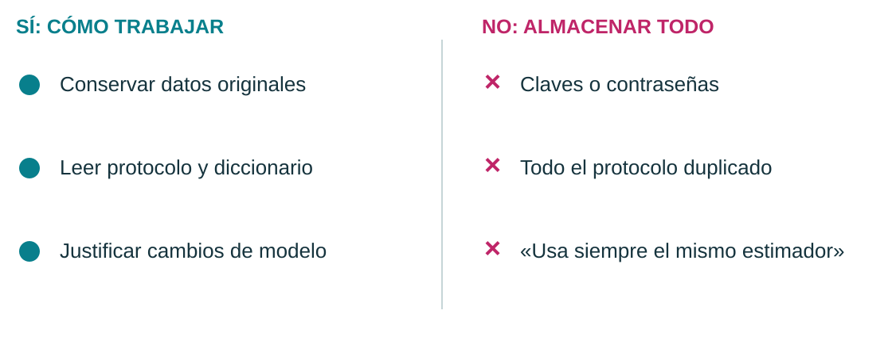

:::

::: {#no-agents-takeaway bento-slot="takeaway"}

Menos duplicación; más contexto pertinente y verificable.

:::

::: {#no-agents-citation bento-slot="citation"}

Esquema didáctico · no son resultados observados.

:::

::: {#no-agents-notas .notes}
Contrastar pares con el mismo propósito: ayudar a trabajar. Mostrar por qué secretos, protocolos duplicados y recetas universales empeoran el diseño. No incluir un token real ni siquiera como captura.
:::

## La planificación proporcional {#plan-proporcional bento-variant="visual"}

::: {#plan-proporcional-kicker bento-slot="kicker"}

03 / CONTEXTUALIZAR

:::

::: {#plan-proporcional-visual bento-slot="visual"}


:::

::: {#plan-proporcional-takeaway bento-slot="takeaway"}

Planificar es explicitar decisiones; no producir archivos por reflejo.

:::

::: {#plan-proporcional-citation bento-slot="citation"}

Esquema didáctico · no son resultados observados.

:::

::: {#plan-proporcional-notas .notes}
No exigir un plan.md para cada operación. La explicación de objetivos, método y entregables sí es necesaria. Un plan escrito adquiere valor con dependencias, riesgo, coste o decisiones que requieren revisión.
:::

## De un pedido vago a un encargo {#actividad-pedido bento-variant="visual"}

::: {#actividad-pedido-kicker bento-slot="kicker"}

03 / CONTEXTUALIZAR · PRACTICAR

:::

::: {#actividad-pedido-visual bento-slot="visual"}

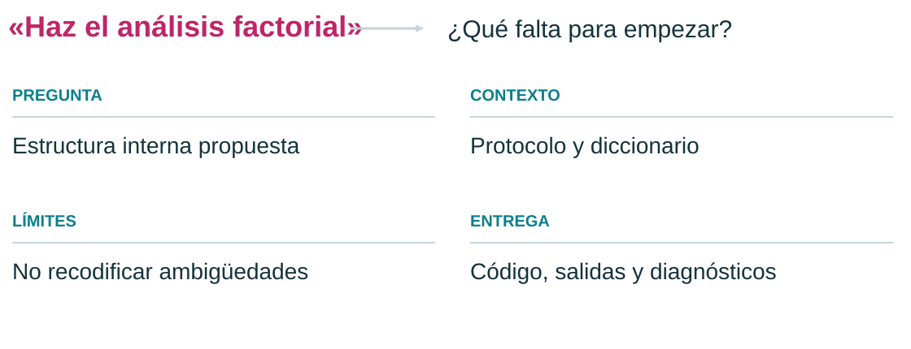

:::

::: {#actividad-pedido-takeaway bento-slot="takeaway"}

Pregunta + contexto + límites + evidencia de entrega.

:::

::: {#actividad-pedido-citation bento-slot="citation"}

Esquema didáctico · no son resultados observados.

:::

::: {#actividad-pedido-notas .notes}
Dar tres minutos para reformular el pedido. Valorar información relevante y control de decisiones, no longitud del prompt. Usar el caso del instrumento, no introducir otro estudio.
:::

## De conocimiento general a procedimiento {#skills-intro bento-variant="section"}

::: {#skills-intro-kicker bento-slot="kicker"}

04 / SKILLS

:::

::: {#skills-intro-number bento-slot="number"}

04

:::

::: {#skills-intro-subtitle bento-slot="subtitle"}

Un modelo puede conocer una técnica sin conocer cómo queremos trabajar.

:::

::: {#skills-intro-notas .notes}
Introducir el papel de instrucciones reutilizables. Las skills no reentrenan el modelo ni eliminan la evaluación metodológica. El taller consumirá el monorepo en desarrollo.
:::

## Cómo se utiliza una skill {#skills-carga bento-variant="visual"}

::: {#skills-carga-kicker bento-slot="kicker"}

04 / SKILLS

:::

::: {#skills-carga-visual bento-slot="visual"}

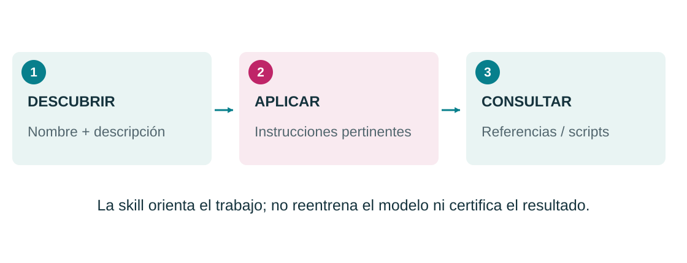

:::

::: {#skills-carga-takeaway bento-slot="takeaway"}

Procedimiento reutilizable, no garantía de especialización.

:::

::: {#skills-carga-citation bento-slot="citation"}

Agent Skills: especificación oficial, agentskills.io/specification, consultada 29-10-2026.

:::

::: {#skills-carga-notas .notes}
Explicar la selección por nombre/descripción y la carga del procedimiento, con referencias cuando corresponde. La activación exacta depende del agente. No afirmar que un modelo sigue perfectamente las instrucciones.
:::

## Una skill real de nuestro repositorio {#skill-real bento-variant="wide"}

::: {#skill-real-kicker bento-slot="kicker"}

04 / SKILLS · CAPTURA PROPIA

:::

::: {#skill-real-visual bento-slot="visual"}


:::

::: {#skill-real-takeaway bento-slot="takeaway"}

Lee la finalidad, el alcance y los límites antes de utilizarla.

:::

::: {#skill-real-citation bento-slot="citation"}

Captura propia · r-analytic-core / r-analytic-coding-principles · consulta local 29-10-2026

:::

::: {#skill-real-notas .notes}
Mostrar el archivo existente sin modificar el monorepo. El encabezado identifica cuándo se usa; la introducción explica la prioridad de editabilidad y transparencia. La captura es del archivo real, no de una skill psicométrica imaginada. No se afirma que un agente la haya cargado.
:::

## Qué mirar dentro de SKILL.md {#skill-anatomia bento-variant="comparison"}

::: {#skill-anatomia-kicker bento-slot="kicker"}

04 / SKILLS

:::

::: {#skill-anatomia-left-label bento-slot="left-label"}

Tres preguntas sobre la cabecera

:::

::: {#skill-anatomia-left bento-slot="left"}

**name:** ¿cómo se identifica?  
**description:** ¿cuándo se activa?  
**Cuerpo:** ¿qué procedimiento propone?

:::

::: {#skill-anatomia-right-label bento-slot="right-label"}

Más allá del archivo principal

:::

::: {#skill-anatomia-right bento-slot="right"}

Referencias para profundizar.  
Scripts que debemos inspeccionar.  
Alcance, límites y ejemplos comprobables.

:::

::: {#skill-anatomia-takeaway bento-slot="takeaway"}

Una skill breve puede enlazar detalles sin cargarlos todos al principio.

:::

::: {#skill-anatomia-citation bento-slot="citation"}

Agent Skills: formato SKILL.md; ejemplo real en r-workflow-plugins.

:::

::: {#skill-anatomia-notas .notes}
Usar la captura anterior como objeto de referencia. Descripción no es publicidad: debe orientar la selección de tareas. Una buena skill distingue reglas de código de decisiones científicas del proyecto.
:::

## Mismo cálculo, distinta legibilidad {#codigo-legible bento-variant="comparison"}

::: {#codigo-legible-kicker bento-slot="kicker"}

04 / SKILLS · CONTRASTE CONTROLADO

:::

::: {#codigo-legible-left-label bento-slot="left-label"}

Compacto, difícil de revisar

:::

::: {#codigo-legible-left bento-slot="left" .bento-code}

```{#codigo-legible-left-source .r}
x <- c(1, 2, 3, 4, 99)
mean(replace(x, x == 99, NA),
     na.rm = TRUE)
```

:::

::: {#codigo-legible-right-label bento-slot="right-label"}

Decisiones a la vista

:::

::: {#codigo-legible-right bento-slot="right" .bento-code}

```{#codigo-legible-right-source .r}
respuestas_limpias <- replace(
  respuestas,
  respuestas == 99,
  NA
)
mean(respuestas_limpias,
     na.rm = TRUE)
```

:::

::: {#codigo-legible-takeaway bento-slot="takeaway"}

La brevedad del código no es el objetivo principal del análisis.

:::

::: {#codigo-legible-citation bento-slot="citation"}

Microejemplo ficticio · R 4.6.1 · materiales/microcaso/01_microcaso.R

:::

::: {#codigo-legible-notas .notes}
Comparación elaborada por el docente, no un ensayo de rendimiento de agentes ni una prueba causal del efecto de la skill. Ambas expresiones calculan 2.5 con la misma entrada. Señalar los nombres, la transformación y la decisión sobre perdidos. La versión derecha presupone respuestas definido en el script canónico.
:::

## Una instrucción no es una herramienta {#dos-skills bento-variant="visual"}

::: {#dos-skills-kicker bento-slot="kicker"}

04 / SKILLS

:::

::: {#dos-skills-visual bento-slot="visual"}

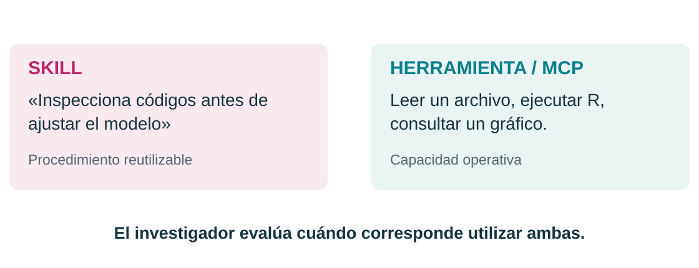

:::

::: {#dos-skills-takeaway bento-slot="takeaway"}

La skill encamina el trabajo; el investigador juzga su pertinencia.

:::

::: {#dos-skills-citation bento-slot="citation"}

Esquema didáctico · no son resultados observados.

:::

::: {#dos-skills-notas .notes}
Distinguir qué procedimiento utilizar de qué operación está disponible. Una skill puede orientar auditoría y legibilidad; MCP puede facilitar acceso a R. El criterio metodológico sigue fuera de esa automatización.
:::

## Antes de adoptar una skill {#skills-confianza bento-variant="visual"}

::: {#skills-confianza-kicker bento-slot="kicker"}

04 / SKILLS

:::

::: {#skills-confianza-visual bento-slot="visual"}


:::

::: {#skills-confianza-takeaway bento-slot="takeaway"}

Revisar también lo que la skill puede ejecutar.

:::

::: {#skills-confianza-citation bento-slot="citation"}

Esquema didáctico · no son resultados observados.

:::

::: {#skills-confianza-notas .notes}
Dar un ejemplo de recomendación metodológica rígida y otro de script externo no revisado. Inspeccionar procedencia, contenido, permisos y pruebas. No ejecutar recursos de terceros durante la explicación.
:::

## Nuestro repositorio como fuente {#skills-proyecto bento-variant="visual"}

::: {#skills-proyecto-kicker bento-slot="kicker"}

04 / SKILLS

:::

::: {#skills-proyecto-visual bento-slot="visual"}

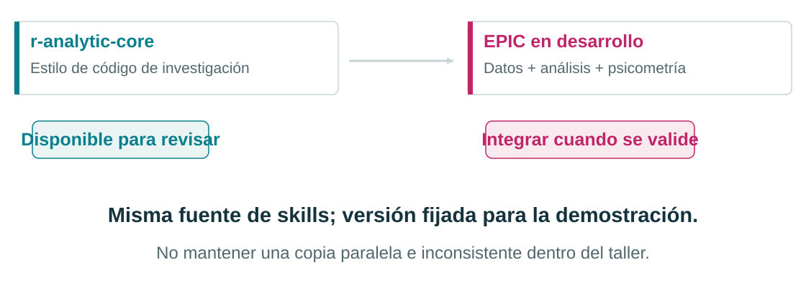

:::

::: {#skills-proyecto-takeaway bento-slot="takeaway"}

Una versión comprobada para la sesión, no una promesa de disponibilidad.

:::

::: {#skills-proyecto-citation bento-slot="citation"}

Instantánea local de r-workflow-plugins consultada 29-10-2026; sin modificar el monorepo.

:::

::: {#skills-proyecto-notas .notes}
Distinguir la skill ya presente r-analytic-coding-principles del EPIC de datos y psicometría. El taller no crea otra implementación paralela. Fijar versión y probarla antes de la demostración final.
:::

## Pausa {#descanso bento-variant="section"}

::: {#descanso-kicker bento-slot="kicker"}

DESCANSO · MINUTOS

:::

::: {#descanso-number bento-slot="number"}

10

:::

::: {#descanso-subtitle bento-slot="subtitle"}

Al volver: aplicar el método a un caso psicométrico y revisar sus decisiones.

:::

::: {#descanso-notas .notes}
Descanso de diez minutos incluido en las tres horas. Mantener la sesión y los materiales de demostración preparados; no usar este tiempo para instalaciones improvisadas.
:::

## Del diccionario al modelo {#caso-portada bento-variant="section"}

::: {#caso-portada-kicker bento-slot="kicker"}

05 / CASO PSICOMÉTRICO

:::

::: {#caso-portada-number bento-slot="number"}

05

:::

::: {#caso-portada-subtitle bento-slot="subtitle"}

Una escala sintética: documentar, inspeccionar, decidir y comprobar.

:::

::: {#caso-portada-notas .notes}
Iniciar la demostración integrada. La preparación de 500 casos, 12 ítems y dos dimensiones continúa pendiente; no mostrar índices inventados. El microejemplo de cinco respuestas ya tiene código y salidas de referencia.
:::

## Respuestas ordinales {#caso-diseno bento-variant="visual"}

::: {#caso-diseno-kicker bento-slot="kicker"}

05 / CASO PSICOMÉTRICO

:::

::: {#caso-diseno-visual bento-slot="visual"}

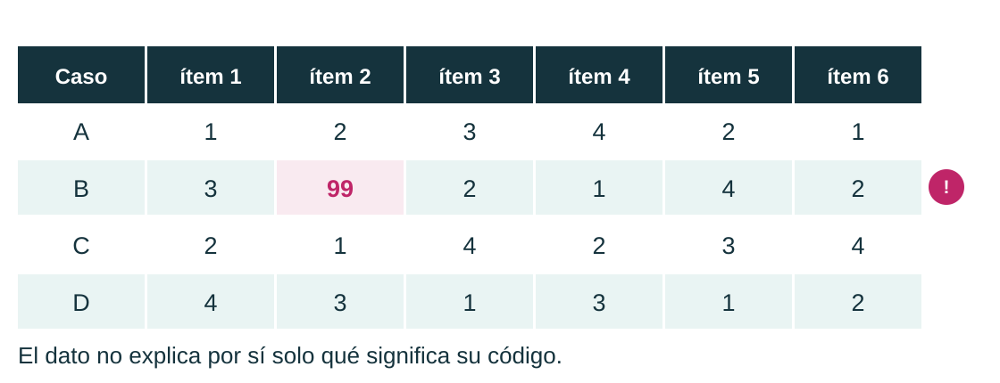

:::

::: {#caso-diseno-takeaway bento-slot="takeaway"}

Primero, entender la estructura y los códigos.

:::

::: {#caso-diseno-citation bento-slot="citation"}

Ilustración ficticia · el caso completo previsto es de 500 casos, 12 ítems y 2 dimensiones.

:::

::: {#caso-diseno-notas .notes}
Matriz ilustrativa ficticia, no resultados de la escala final. Pedir que identifiquen qué cosas inspeccionarían antes de un análisis. El código 99 obliga a consultar el diccionario; ninguna recodificación se decide solo por su magnitud.
:::

## La pregunta de investigación {#caso-pregunta bento-variant="question"}

::: {#caso-pregunta-kicker bento-slot="kicker"}

05 / CASO PSICOMÉTRICO

:::

::: {#caso-pregunta-question bento-slot="question"}

¿Qué evidencia respalda la estructura interna propuesta?

:::

::: {#caso-pregunta-prompt bento-slot="prompt"}

Después: ¿qué fiabilidad tienen las puntuaciones de cada dimensión?

:::

::: {#caso-pregunta-notas .notes}
Separar objetivos. Las preguntas proceden del diseño del caso ya acordado. Ni el agente ni el ajuste de un modelo deben redefinirlas silenciosamente.
:::

## El diccionario antes de recodificar {#caso-auditoria bento-variant="comparison"}

::: {#caso-auditoria-kicker bento-slot="kicker"}

05 / CASO PSICOMÉTRICO

:::

::: {#caso-auditoria-left-label bento-slot="left-label"}

Dato observado en el microejemplo

:::

::: {#caso-auditoria-left bento-slot="left" .bento-code}

```{#caso-auditoria-left-source .r}
respuestas <- c(1, 2, 3, 4, 99)
mean(respuestas)
# [1] 21.8
```

:::

::: {#caso-auditoria-right-label bento-slot="right-label"}

Documentación que decide el sentido

:::

::: {#caso-auditoria-right bento-slot="right"}

**Categorías válidas:** 1, 2, 3 y 4.  
**Código 99:** respuesta perdida.  
No es una quinta categoría ni un valor extremo interpretable.

:::

::: {#caso-auditoria-takeaway bento-slot="takeaway"}

El agente puede detectar una anomalía; el diccionario explica su significado.

:::

::: {#caso-auditoria-citation bento-slot="citation"}

Microejemplo ficticio · R 4.6.1 · materiales/microcaso/01_microcaso.R

:::

::: {#caso-auditoria-notas .notes}
Usar diccionario.csv del microejemplo. Los resultados del código están verificados. El texto de la derecha es la fuente que autoriza recodificar, no una conjetura de la IA.
:::

## La corrección documentada {#caso-correccion bento-variant="visual"}

::: {#caso-correccion-kicker bento-slot="kicker"}

05 / CASO PSICOMÉTRICO · RESOLVER

:::

::: {#caso-correccion-visual bento-slot="visual"}

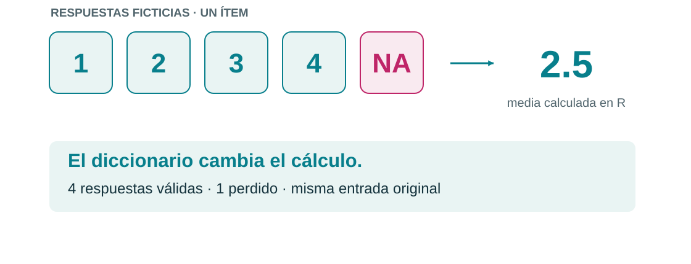

:::

::: {#caso-correccion-takeaway bento-slot="takeaway"}

La corrección debe quedar en código y conservar el original.

:::

::: {#caso-correccion-citation bento-slot="citation"}

Microejemplo ficticio · R 4.6.1 · materiales/microcaso/01_microcaso.R

:::

::: {#caso-correccion-notas .notes}
Regresar al mismo vector del inicio y cambiar solo el tratamiento documentado de 99. R devuelve 2.5 y cuatro respuestas válidas. Esta media ilustra una decisión de limpieza; no es un análisis de fiabilidad ni una validación de la escala.
:::

## La salida real de R {#r-salida-real bento-variant="wide"}

::: {#r-salida-real-kicker bento-slot="kicker"}

05 / CASO PSICOMÉTRICO · CAPTURA PROPIA

:::

::: {#r-salida-real-visual bento-slot="visual"}


:::

::: {#r-salida-real-takeaway bento-slot="takeaway"}

Los números del relato deben coincidir con la evidencia de ejecución.

:::

::: {#r-salida-real-citation bento-slot="citation"}

Captura propia de consola · salida comprobada también con Rscript --vanilla.

:::

::: {#r-salida-real-notas .notes}
Mostrar la ampliación para poder leer el resultado. Esta consola procede de una sesión R real en un perfil aislado de Positron; no es una captura simulada ni una conversación inventada con un agente. Contrastar con el archivo salida_referencia.txt.
:::

## Ítems invertidos: la clave importa {#item-inverso bento-variant="visual"}

::: {#item-inverso-kicker bento-slot="kicker"}

05 / CASO PSICOMÉTRICO

:::

::: {#item-inverso-visual bento-slot="visual"}

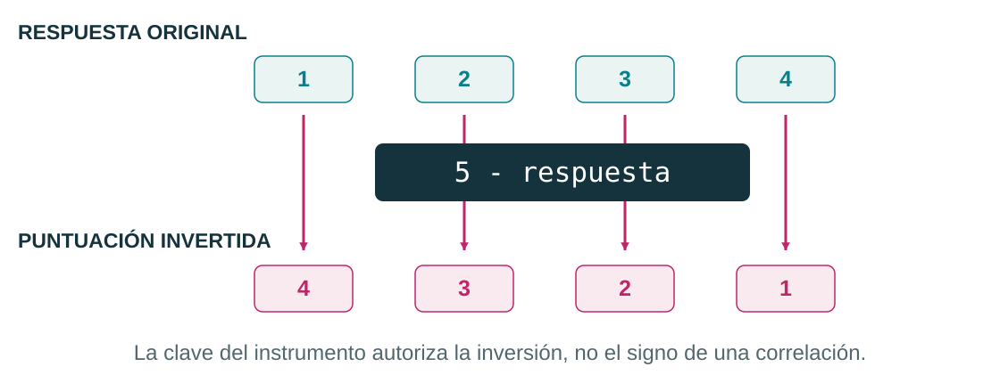

:::

::: {#item-inverso-takeaway bento-slot="takeaway"}

No automatizar una decisión sustantiva a partir de un signo.

:::

::: {#item-inverso-citation bento-slot="citation"}

Esquema didáctico · no son resultados observados.

:::

::: {#item-inverso-notas .notes}
Esquema de recodificación de una escala de 1 a 4. La fórmula 5 menos respuesta es correcta solo si las categorías y la clave lo justifican. No invertir un ítem por una correlación negativa sin revisar contenido y documentación.
:::

## La estructura que vamos a contrastar {#modelo-propuesto bento-variant="visual"}

::: {#modelo-propuesto-kicker bento-slot="kicker"}

05 / CASO PSICOMÉTRICO

:::

::: {#modelo-propuesto-visual bento-slot="visual"}


:::

::: {#modelo-propuesto-takeaway bento-slot="takeaway"}

El modelo expresa una hipótesis; no es un dibujo que el agente deba adivinar.

:::

::: {#modelo-propuesto-citation bento-slot="citation"}

Esquema del modelo propuesto · sin parámetros estimados ni evidencia empírica.

:::

::: {#modelo-propuesto-notas .notes}
Dos factores correlacionados y doce indicadores; los nombres de dimensiones son didácticos y corresponden a autorregulación académica. No hay cargas ni índices ajustados en el dibujo. Antes de ejecutar, revisar teoría, identificación y tratamiento de respuestas ordinales.
:::

## Decisiones antes del AFC {#caso-decision bento-variant="comparison"}

::: {#caso-decision-kicker bento-slot="kicker"}

05 / CASO PSICOMÉTRICO

:::

::: {#caso-decision-left-label bento-slot="left-label"}

Sintaxis ilustrativa, no ejecutada

:::

::: {#caso-decision-left bento-slot="left" .bento-code}

```{#caso-decision-left-source .r}
ajuste <- lavaan::cfa(
  modelo,
  data = datos,
  ordered = items,
  estimator = "WLSMV"
)
```

:::

::: {#caso-decision-right-label bento-slot="right-label"}

Preguntas que no resuelve la sintaxis

:::

::: {#caso-decision-right bento-slot="right"}

¿Qué categorías y patrones hay?  
¿Cómo se tratan los perdidos?  
¿El modelo y el estimador son pertinentes?

:::

::: {#caso-decision-takeaway bento-slot="takeaway"}

Los argumentos de una función también contienen decisiones metodológicas.

:::

::: {#caso-decision-citation bento-slot="citation"}

lavaan: tutorial de datos categóricos. Caso completo pendiente de ejecución.

:::

::: {#caso-decision-notas .notes}
Esta es una ilustración docente, no código para ejecutar con el microejemplo de un ítem. WLSMV es candidato para el caso ordinal, no regla universal. Un argumento bien escrito no demuestra la pertinencia estadística.
:::

## Autonomía con puntos de revisión {#caso-ejecucion bento-variant="visual"}

::: {#caso-ejecucion-kicker bento-slot="kicker"}

05 / CASO PSICOMÉTRICO

:::

::: {#caso-ejecucion-visual bento-slot="visual"}


:::

::: {#caso-ejecucion-takeaway bento-slot="takeaway"}

Permisos proporcionales; decisiones científicas explícitas.

:::

::: {#caso-ejecucion-citation bento-slot="citation"}

Esquema didáctico · no son resultados observados.

:::

::: {#caso-ejecucion-notas .notes}
Recorrer los carriles. Aprobar decisiones sustantivas no significa autorizar cada comando. Las operaciones rutinarias de lectura pueden estar preautorizadas, mientras que cambiar el modelo o la codificación requiere revisión.
:::

## El encargo para la demostración {#caso-prompt bento-variant="comparison"}

::: {#caso-prompt-kicker bento-slot="kicker"}

05 / CASO PSICOMÉTRICO

:::

::: {#caso-prompt-left-label bento-slot="left-label"}

Primero: comprender e inspeccionar

:::

::: {#caso-prompt-left bento-slot="left" .bento-code}

```{#caso-prompt-left-source .text}
Lee protocolo y diccionario.
Identifica la pregunta del estudio.
Audita ítems y códigos con R.
No recodifiques ambigüedades.
```

:::

::: {#caso-prompt-right-label bento-slot="right-label"}

Después: actuar y justificar

:::

::: {#caso-prompt-right bento-slot="right" .bento-code}

```{#caso-prompt-right-source .text}
Explica decisiones pendientes.
Espera aprobación del método.
Ejecuta código legible.
Guarda salidas y diagnósticos.
```

:::

::: {#caso-prompt-takeaway bento-slot="takeaway"}

La tarea y los controles importan más que una formulación sofisticada.

:::

::: {#caso-prompt-citation bento-slot="citation"}

Texto docente · versión extendida en materiales/prompts-demostracion.md.

:::

::: {#caso-prompt-notas .notes}
No es un prompt mágico. Acompañarlo del contexto real y las skills probadas. Durante el bloque principal se trabaja en el IDE, no se leen todas las instrucciones desde la diapositiva.
:::

## Tu turno: localizar el fallo {#caso-error bento-variant="question"}

::: {#caso-error-kicker bento-slot="kicker"}

05 / CASO PSICOMÉTRICO · AUDITAR

:::

::: {#caso-error-question bento-slot="question"}

El script corre. El 99 quedó como respuesta válida.

:::

::: {#caso-error-prompt bento-slot="prompt"}

¿Qué revisarías, qué corregirías y qué análisis volverías a ejecutar?

:::

::: {#caso-error-notas .notes}
Error deliberado. No atribuirlo a un agente concreto. Pedir que conecten decisiones de preparación con resultados posteriores y documenten la corrección antes de recalcular.
:::

## Después de la convergencia {#caso-diagnostico bento-variant="visual"}

::: {#caso-diagnostico-kicker bento-slot="kicker"}

05 / CASO PSICOMÉTRICO

:::

::: {#caso-diagnostico-visual bento-slot="visual"}


:::

::: {#caso-diagnostico-takeaway bento-slot="takeaway"}

Un algoritmo que termina todavía deja preguntas importantes.

:::

::: {#caso-diagnostico-citation bento-slot="citation"}

Esquema didáctico · no son resultados observados.

:::

::: {#caso-diagnostico-notas .notes}
Introducir el significado de converger: el procedimiento alcanzó un criterio de parada. Luego inspeccionar solución, ajuste y sentido sustantivo. El diagrama es guía de revisión, no el reporte de un modelo corrido ni un criterio universal de aprobación.
:::

## Volver a empezar desde los archivos {#caso-repro bento-variant="visual"}

::: {#caso-repro-kicker bento-slot="kicker"}

05 / CASO PSICOMÉTRICO

:::

::: {#caso-repro-visual bento-slot="visual"}

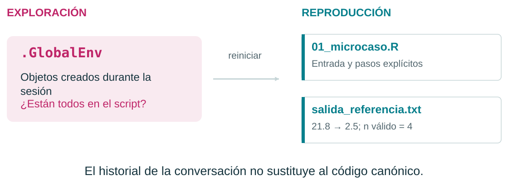

:::

::: {#caso-repro-takeaway bento-slot="takeaway"}

Reproducir el cálculo también permite reproducir un error: todavía hay que interpretarlo.

:::

::: {#caso-repro-citation bento-slot="citation"}

Microejemplo ficticio · R 4.6.1 · materiales/microcaso/01_microcaso.R

:::

::: {#caso-repro-notas .notes}
Mostrar sesión persistente frente a ejecución limpia. Usar el microejemplo para comprobarlo ahora y repetir en el caso completo cuando esté preparado. La reproducción exige código, entradas y condiciones; no la memoria del agente.
:::

## Del resultado a la conclusión {#actividad-auditoria bento-variant="visual"}

::: {#actividad-auditoria-kicker bento-slot="kicker"}

06 / AUDITORÍA Y TRANSFERENCIA

:::

::: {#actividad-auditoria-visual bento-slot="visual"}

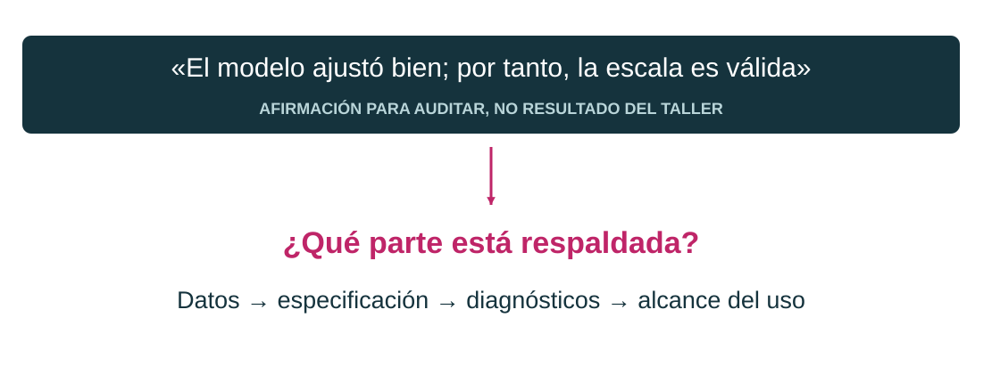

:::

::: {#actividad-auditoria-takeaway bento-slot="takeaway"}

¿Qué parte de la afirmación está respaldada y cuál excede la evidencia?

:::

::: {#actividad-auditoria-citation bento-slot="citation"}

Esquema didáctico · no son resultados observados.

:::

::: {#actividad-auditoria-notas .notes}
Actividad final. La frase es deliberadamente excesiva, no resultado del caso. Pedir fuentes de evidencia y límites. Un ajuste favorable de estructura interna no establece por sí solo todos los usos de las puntuaciones.
:::

## Cuatro controles del trabajo {#riesgos bento-variant="visual"}

::: {#riesgos-kicker bento-slot="kicker"}

06 / AUDITORÍA Y TRANSFERENCIA

:::

::: {#riesgos-visual bento-slot="visual"}

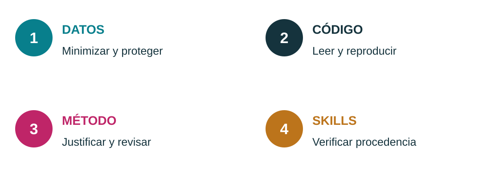

:::

::: {#riesgos-takeaway bento-slot="takeaway"}

Un análisis supervisado deja evidencia, no solo una respuesta convincente.

:::

::: {#riesgos-citation bento-slot="citation"}

Esquema didáctico · no son resultados observados.

:::

::: {#riesgos-notas .notes}
Sintetizar datos, código, método y skills. Reforzar que ninguna regla textual reemplaza permisos reales o políticas de privacidad. Mantener la distinción entre control computacional y evaluación metodológica.
:::

## El mismo método, otros análisis {#transferencia bento-variant="visual"}

::: {#transferencia-kicker bento-slot="kicker"}

06 / AUDITORÍA Y TRANSFERENCIA

:::

::: {#transferencia-visual bento-slot="visual"}

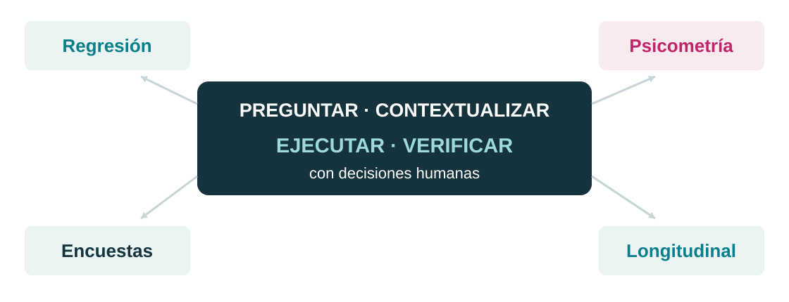

:::

::: {#transferencia-takeaway bento-slot="takeaway"}

La competencia transferible es dirigir y auditar el proceso.

:::

::: {#transferencia-citation bento-slot="citation"}

Esquema didáctico · no son resultados observados.

:::

::: {#transferencia-notas .notes}
Mostrar que se conserva el método, pero cambian el diseño, las variables, los supuestos, el modelo y las skills pertinentes. Ejemplificar regresión sin iniciar otro análisis completo.
:::

## Cuatro distinciones esenciales {#cuatro-ideas bento-variant="summary"}

::: {#cuatro-ideas-kicker bento-slot="kicker"}

CIERRE

:::

::: {#cuatro-ideas-first bento-slot="first"}

**Generar** no equivale a **calcular**.

:::

::: {#cuatro-ideas-second bento-slot="second"}

**Contextualizar** no equivale a **acumular instrucciones**.

:::

::: {#cuatro-ideas-third bento-slot="third"}

**Especializar** no equivale a **garantizar la corrección**.

:::

::: {#cuatro-ideas-fourth bento-slot="fourth"}

**Delegar ejecución** no equivale a **delegar responsabilidad**.

:::

::: {#cuatro-ideas-notas .notes}
Recuperar el 99 inicial y pedir que asocien cada contraste con una evidencia vista durante la sesión. Cierre sin nuevos conceptos técnicos.
:::

## Antes de tu próximo análisis {#ticket-salida bento-variant="question"}

::: {#ticket-salida-kicker bento-slot="kicker"}

CIERRE · TRANSFERIR

:::

::: {#ticket-salida-question bento-slot="question"}

¿Qué le entregarías hoy a un agente que ayer no le habrías dado?

:::

::: {#ticket-salida-prompt bento-slot="prompt"}

Responde con un documento, una restricción y una comprobación concreta.

:::

::: {#ticket-salida-notas .notes}
Ticket de salida de dos minutos. Buscar respuestas sobre contexto, permisos y evidencia, no nombres de modelos.
:::

## Un proyecto para seguir practicando {#recursos bento-variant="comparison"}

::: {#recursos-kicker bento-slot="kicker"}

CIERRE · MATERIALES

:::

::: {#recursos-left-label bento-slot="left-label"}

Recursos de aprendizaje

:::

::: {#recursos-left bento-slot="left" .bento-code}

```{#recursos-left-source .text}
materiales/
  microcaso/
  plantilla-proyecto/
  actividades.md
  guia-para-evaluar-skills.md
```

:::

::: {#recursos-right-label bento-slot="right-label"}

Ejecutar el microejemplo

:::

::: {#recursos-right bento-slot="right" .bento-code}

```{#recursos-right-source .bash}
Rscript --vanilla \
  materiales/microcaso/01_microcaso.R
```

:::

::: {#recursos-takeaway bento-slot="takeaway"}

Practica el método antes de aumentar la complejidad.

:::

::: {#recursos-citation bento-slot="citation"}

Proyecto local del taller · fuentes, notas y scripts separados.

:::

::: {#recursos-notas .notes}
Separar material ya ejecutable de la integración futura del caso factorial y skills. No vender una validación completada. El microejemplo puede reproducirse sin cuenta de IA. Los handouts conservan detalle que no cabe en la proyección.
:::

## Configurar un proveedor {#apendice-proveedor bento-variant="wide"}

::: {#apendice-proveedor-kicker bento-slot="kicker"}

APOYO · FUERA DEL RECORRIDO PRINCIPAL

:::

::: {#apendice-proveedor-visual bento-slot="visual"}

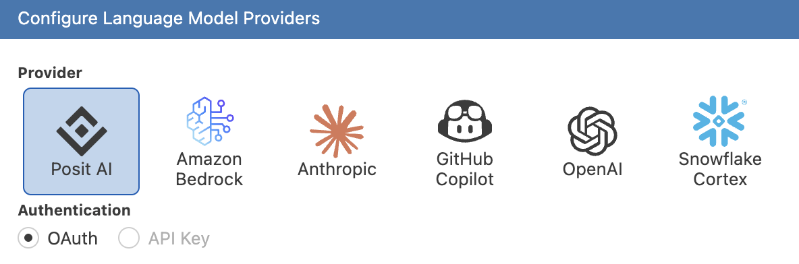

:::

::: {#apendice-proveedor-takeaway bento-slot="takeaway"}

La configuración concreta depende del producto y de su versión.

:::

::: {#apendice-proveedor-citation bento-slot="citation"}

Posit: guía de inicio de Posit AI. Captura oficial; proveedores sujetos a disponibilidad.

:::

::: {#apendice-proveedor-notas .notes}
Apoyo para preguntas, no instalación durante la sesión. La captura oficial muestra un proveedor específico; no obliga a elegirlo. Consultar documentación vigente, términos y acceso antes de usar credenciales. No mostrar claves reales.
:::

## Fuentes de herramientas y formatos {#referencias-herramientas bento-variant="references"}

::: {#referencias-herramientas-kicker bento-slot="kicker"}

APOYO · REFERENCIAS

:::

::: {#referencias-herramientas-left bento-slot="left"}

**Positron / MCP**  
Posit, October Release Highlights (13-10-2026).  
**Posit Assistant**  
Getting Started y Providers.  
**R Core**  
Random Number Generation: set.seed / RNGversion.

:::

::: {#referencias-herramientas-right bento-slot="right"}

**AGENTS.md**  
Convención oficial: agents.md.  
**Agent Skills**  
Specification: agentskills.io.  
**Agentes de codificación**  
Documentación de Codex, Claude Code y Gemini CLI.

:::

::: {#referencias-herramientas-citation bento-slot="citation"}

Documentación oficial consultada el 29-10-2026.

:::

::: {#referencias-herramientas-notas .notes}
Referencias completas con enlaces y fechas en docs/fuentes.md. No mostrar enlaces extensos en la proyección. Las capturas originales y sus derivados tienen registro de procedencia.
:::

## Fuentes y límites del material {#referencias-materiales bento-variant="references"}

::: {#referencias-materiales-kicker bento-slot="kicker"}

APOYO · REFERENCIAS

:::

::: {#referencias-materiales-left bento-slot="left"}

**Skill de R**  
r-workflow-plugins: r-analytic-coding-principles.  
**AFC ordinal**  
lavaan: tutorial de datos categóricos.  
**Cálculos del ejemplo**  
Script y salida real de R en materiales/microcaso/.

:::

::: {#referencias-materiales-right bento-slot="right"}

**Diagramas**  
Esquemas didácticos; no resultados empíricos.  
**Capturas**  
Propias en perfil aislado u oficiales de Posit, identificadas.  
**Caso completo**  
No se presentan índices de ajuste ni coeficientes no calculados.

:::

::: {#referencias-materiales-citation bento-slot="citation"}

Consultar docs/fuentes.md y assets/screenshots/provenance.json.

:::

::: {#referencias-materiales-notas .notes}
Distinguir fuente, ejemplo conceptual y evidencia computacional. La referencia metodológica definitiva del caso se completará con la integración y evaluación de las skills. Esta distinción no resta valor al microejemplo ya comprobado.
:::
