## Uso de Agentes IA para análisis de datos e investigación {#inicio bento-variant="hero"}

::: {#inicio-kicker bento-slot="kicker"}

SOCIEDAD PERUANA DE PSICOMETRÍA · TALLER VIRTUAL

:::

::: {#inicio-visual bento-slot="visual"}


:::

::: {#inicio-subtitle bento-slot="subtitle"}

Una introducción al trabajo con agentes, con aplicaciones al análisis psicométrico.

:::

::: {#inicio-citation bento-slot="citation"}

Brian Norman Peña Calero · 3 horas · R como motor de ejecución

:::

::: {#inicio-notas .notes}
Presentar el título difundido y la promesa introductoria. Abrir con qué aprenderemos y qué no. No mostrar código ni el ejemplo de 99 en la apertura. La meta es incorporar agentes sin perder la posibilidad de continuar el análisis por nuestra cuenta.
:::

## Qué aprenderemos y qué no {#encuadre bento-variant="visual"}

::: {#encuadre-kicker bento-slot="kicker"}

01 / PRESENTACIÓN

:::

::: {#encuadre-visual bento-slot="visual"}

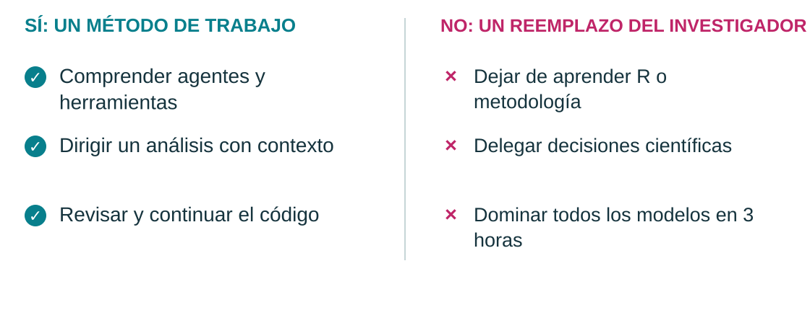

:::

::: {#encuadre-takeaway bento-slot="takeaway"}

Aprender a dirigir y revisar un análisis, no a dejar de comprenderlo.

:::

::: {#encuadre-citation bento-slot="citation"}

Esquema didáctico; no resultado de una investigación.

:::

::: {#encuadre-notas .notes}
Explicar el alcance antes de entrar en herramientas. Aprenderemos a comprender, encuadrar y supervisar un agente; usaremos R y un ejemplo psicométrico. No sustituye formación en programación o metodología, ni promete investigación autónoma. La sesión no intenta enseñar todos los modelos estadísticos ni todos los agentes.
:::

## Punto de partida {#sondeo-inicial bento-variant="question"}

::: {#sondeo-inicial-kicker bento-slot="kicker"}

01 / PRESENTACIÓN

:::

::: {#sondeo-inicial-question bento-slot="question"}

¿Hasta dónde has trabajado con IA?

:::

::: {#sondeo-inicial-prompt bento-slot="prompt"}

En el chat: 1 = conversación; 2 = código sugerido; 3 = herramientas; 4 = análisis ejecutado.

:::

::: {#sondeo-inicial-notas .notes}
Sondeo breve y opcional sobre experiencia con chat, código sugerido y herramientas locales. No presentar un ejercicio estadístico todavía. Graduar el detalle de las analogías según las respuestas.
:::

## El recorrido de hoy {#tres-preguntas bento-variant="visual"}

::: {#tres-preguntas-kicker bento-slot="kicker"}

01 / PRESENTACIÓN

:::

::: {#tres-preguntas-visual bento-slot="visual"}

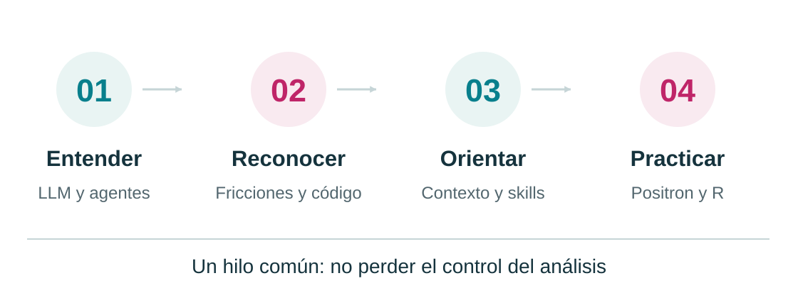

:::

::: {#tres-preguntas-takeaway bento-slot="takeaway"}

Primero entender la necesidad; después elegir y configurar la herramienta.

:::

::: {#tres-preguntas-citation bento-slot="citation"}

Esquema didáctico · no son resultados observados.

:::

::: {#tres-preguntas-notas .notes}
Anticipar el recorrido: fundamentos; trabajo analítico; fricciones del chat; agentes y código revisable; contexto e instrucciones; Positron y práctica. No es un temario de tecnologías desconectadas.
:::

## Un redactor que trabaja con contexto {#modelo-probabilistico bento-variant="visual"}

::: {#modelo-probabilistico-kicker bento-slot="kicker"}

02 / FUNDAMENTOS

:::

::: {#modelo-probabilistico-visual bento-slot="visual"}

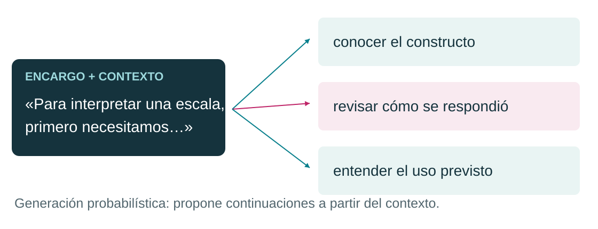

:::

::: {#modelo-probabilistico-takeaway bento-slot="takeaway"}

LLM: modelo de lenguaje. Genera propuestas; no certifica su verdad.

:::

::: {#modelo-probabilistico-citation bento-slot="citation"}

Esquema didáctico · no son resultados observados.

:::

::: {#modelo-probabilistico-notas .notes}
Usar la analogía de un redactor que completa un encargo atendiendo al contexto. El modelo representa distribuciones de continuaciones; las alternativas dibujadas no son probabilidades medidas. No reducir todas sus capacidades a completar una palabra: la analogía solo introduce generación condicionada. La decodificación puede hacer más consistentes las respuestas; probabilístico no exige que cada ejecución sea distinta.
:::

## Algunos nombres conocidos {#familias-llm bento-variant="visual"}

::: {#familias-llm-kicker bento-slot="kicker"}

02 / FUNDAMENTOS

:::

::: {#familias-llm-visual bento-slot="visual"}

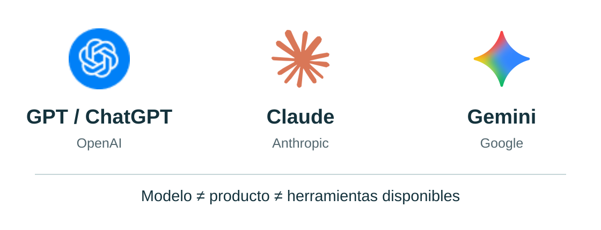

:::

::: {#familias-llm-takeaway bento-slot="takeaway"}

Reconocer una marca no basta para saber qué herramientas tiene disponibles.

:::

::: {#familias-llm-citation bento-slot="citation"}

Iconos obtenidos de sitios oficiales de OpenAI, Anthropic y Google; atribución en assets/brands/.

:::

::: {#familias-llm-notas .notes}
Mostrar tres marcas reconocibles, sin ranking ni versiones efímeras. GPT es una familia de modelos y ChatGPT es un producto que los utiliza. Claude y Gemini nombran familias y productos. Los iconos identifican marcas; no representan una comparación de rendimiento ni patrocinio.
:::

## Conversar o actuar sobre el proyecto {#chat-agente-breve bento-variant="visual"}

::: {#chat-agente-breve-kicker bento-slot="kicker"}

02 / FUNDAMENTOS

:::

::: {#chat-agente-breve-visual bento-slot="visual"}

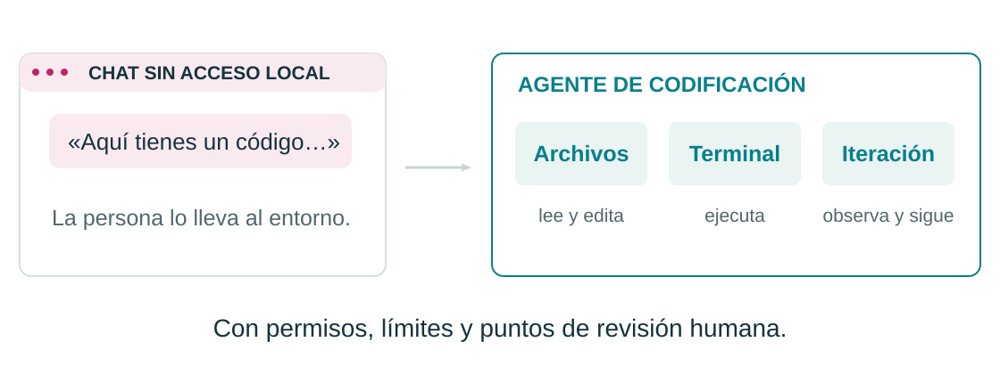

:::

::: {#chat-agente-breve-takeaway bento-slot="takeaway"}

Archivos + terminal + ejecución e iteración, dentro de un alcance autorizado.

:::

::: {#chat-agente-breve-citation bento-slot="citation"}

Documentación de Codex CLI, Claude Code y Gemini CLI; síntesis funcional, no ranking.

:::

::: {#chat-agente-breve-notas .notes}
Dar la distinción operativa en una sola lámina: un chat sin herramientas locales propone texto y código; un agente de codificación puede leer y modificar archivos, usar la terminal y encadenar acciones observando resultados. Siempre según permisos y límites. Algunas interfaces de chat también incorporan herramientas: la frontera está en las capacidades disponibles, no en el aspecto de la ventana.
:::

## Lenguaje, cálculo y criterio {#generar-ejecutar bento-variant="visual"}

::: {#generar-ejecutar-kicker bento-slot="kicker"}

02 / FUNDAMENTOS

:::

::: {#generar-ejecutar-visual bento-slot="visual"}

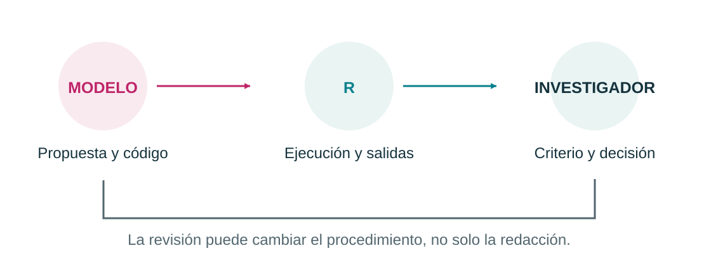

:::

::: {#generar-ejecutar-takeaway bento-slot="takeaway"}

El modelo propone; R ejecuta; el investigador evalúa el significado.

:::

::: {#generar-ejecutar-citation bento-slot="citation"}

Esquema didáctico · no son resultados observados.

:::

::: {#generar-ejecutar-notas .notes}
Contrastar generación probabilística y ejecución de instrucciones. R no verifica por sí mismo la pertinencia del análisis y puede incluir aleatoriedad: reproducibilidad exige datos, código, versiones y semillas cuando corresponda. No introducir sintaxis aún. Este reparto de funciones permite hablar del uso de LLM en análisis de datos.
:::

## Más capacidad, el mismo criterio {#analisis-asistido bento-variant="visual"}

::: {#analisis-asistido-kicker bento-slot="kicker"}

03 / DEL CHAT AL AGENTE

:::

::: {#analisis-asistido-visual bento-slot="visual"}

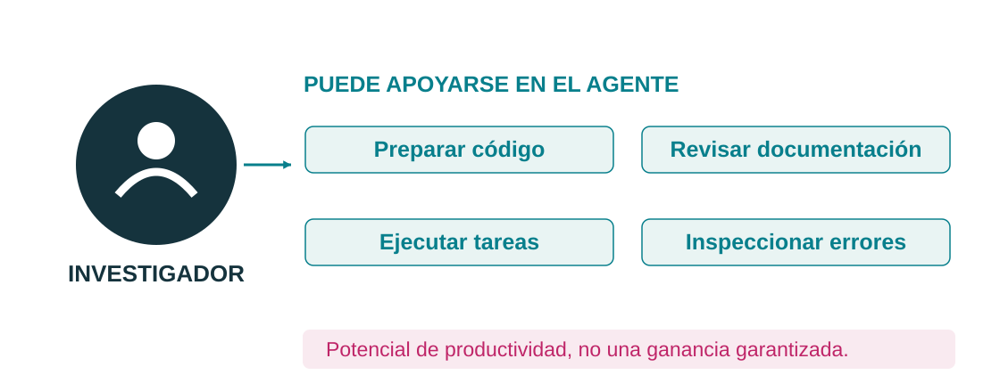

:::

::: {#analisis-asistido-takeaway bento-slot="takeaway"}

Aprovechar la ejecución asistida sin renunciar a comprender el análisis.

:::

::: {#analisis-asistido-citation bento-slot="citation"}

Esquema didáctico; no resultado de una investigación.

:::

::: {#analisis-asistido-notas .notes}
Presentar el potencial: acelerar tareas mecánicas, bosquejar código, explorar documentación y revisar errores. Puede aumentar la productividad al aprender a dirigirlo, pero el beneficio depende de tarea, experiencia y supervisión; no afirmar una ganancia garantizada. No reemplaza aprender a programar ni a juzgar el método. No generalizar que el desarrollo de software prescinde de revisión; la investigación exige una revisión metodológica explícita.
:::

## Un código del que podamos hacernos cargo {#codigo-propio bento-variant="visual"}

::: {#codigo-propio-kicker bento-slot="kicker"}

03 / DEL CHAT AL AGENTE

:::

::: {#codigo-propio-visual bento-slot="visual"}

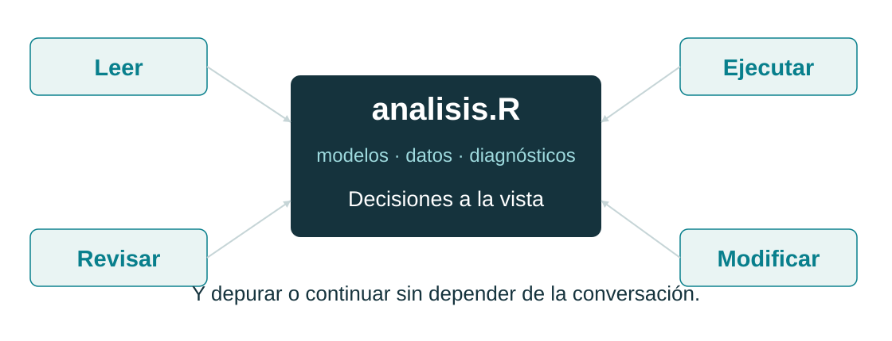

:::

::: {#codigo-propio-takeaway bento-slot="takeaway"}

No queremos un análisis que solo el LLM pueda mantener.

:::

::: {#codigo-propio-citation bento-slot="citation"}

Esquema didáctico; no resultado de una investigación.

:::

::: {#codigo-propio-notas .notes}
Fijar el contrato de aprendizaje: leer, revisar, ejecutar, modificar y depurar, incluso sin el agente. Poder continuar no significa memorizar toda la sintaxis; implica localizar decisiones, entender objetos y seguir diagnósticos. Este objetivo distingue nuestro estilo de análisis. La revisión humana no puede ser nominal si el código es opaco.
:::

## Una petición de análisis en el chat {#chat-necesidad bento-variant="visual"}

::: {#chat-necesidad-kicker bento-slot="kicker"}

03 / DEL CHAT AL AGENTE

:::

::: {#chat-necesidad-visual bento-slot="visual"}

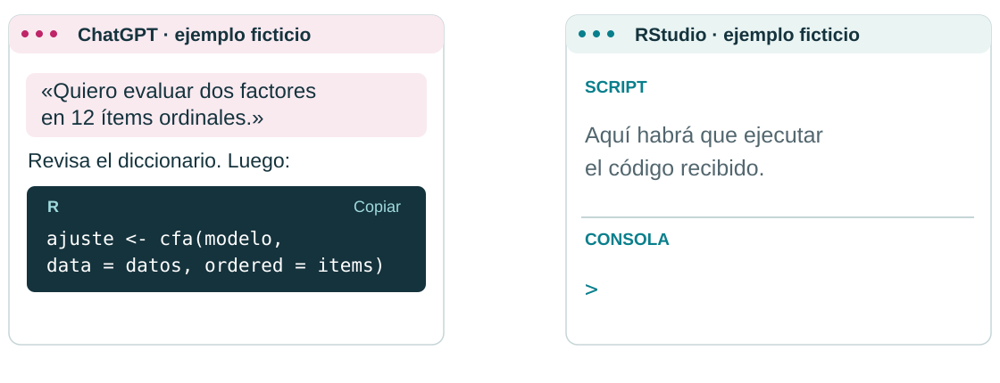

:::

::: {#chat-necesidad-citation bento-slot="citation"}

Recreación esquemática y ficticia; no es una captura ni una ejecución real.

:::

::: {#chat-necesidad-notas .notes}
Mostrar una recreación explícitamente ficticia de ChatGPT web. El usuario pide contrastar dos factores en doce ítems ordinales. La respuesta propone revisar el diccionario y aporta un fragmento de código. No es una captura real ni una respuesta evaluada de un modelo; sirve para seguir el recorrido de trabajo.
:::

## Del bloque de código a RStudio {#chat-traslado bento-variant="visual"}

::: {#chat-traslado-kicker bento-slot="kicker"}

03 / DEL CHAT AL AGENTE

:::

::: {#chat-traslado-visual bento-slot="visual"}

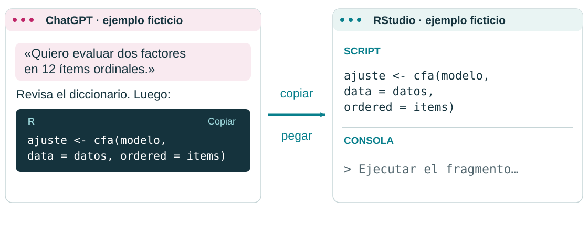

:::

::: {#chat-traslado-citation bento-slot="citation"}

Recreación esquemática y ficticia; no es una captura ni una ejecución real.

:::

::: {#chat-traslado-notas .notes}
Mantener fija la petición y el mismo fragmento de código. La persona copia el bloque del chat y lo pega en un script de RStudio. Mostrar que entre ambas ventanas hay un paso manual. El fragmento está abreviado y no se distribuye como receta de AFC; el método requiere especificación previa. No afirmar que todo copiado produce errores.
:::

## Del error de vuelta al chat {#chat-depuracion bento-variant="visual"}

::: {#chat-depuracion-kicker bento-slot="kicker"}

03 / DEL CHAT AL AGENTE

:::

::: {#chat-depuracion-visual bento-slot="visual"}

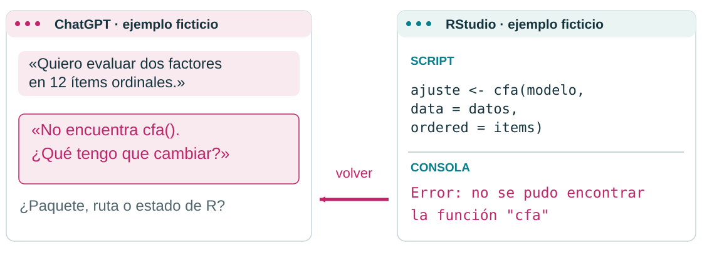

:::

::: {#chat-depuracion-takeaway bento-slot="takeaway"}

El usuario transporta código, resultados y contexto de una ventana a otra.

:::

::: {#chat-depuracion-citation bento-slot="citation"}

Recreación esquemática y ficticia; no es una captura ni una ejecución real.

:::

::: {#chat-depuracion-notas .notes}
En el mismo escenario ficticio, falta cargar una función y aparece un error ilustrativo de R. La persona debe copiar el mensaje, explicar el estado de la sesión y probar otra propuesta. No se atribuye este fallo a un producto concreto ni se representa como ejecución observada. Identificar fricciones posibles: omisiones, bloques desactualizados, objetos de sesión y diagnóstico de rutas o paquetes.
:::

## Una posibilidad distinta {#puente-agente bento-variant="question"}

::: {#puente-agente-kicker bento-slot="kicker"}

03 / DEL CHAT AL AGENTE

:::

::: {#puente-agente-question bento-slot="question"}

¿Y si el LLM pudiera ejecutar el código y observar qué ocurrió?

:::

::: {#puente-agente-prompt bento-slot="prompt"}

Sin que tú tengas que copiar cada resultado de vuelta.

:::

::: {#puente-agente-notas .notes}
Usar esta pregunta como transición, no como actividad larga. La definición breve de agente ya se vio; ahora aparece la razón práctica para usarlo. Mantener visible que poder ejecutar no implica elegir correctamente el método.
:::

## El agente dentro del proyecto {#agente-operando bento-variant="visual"}

::: {#agente-operando-kicker bento-slot="kicker"}

03 / DEL CHAT AL AGENTE

:::

::: {#agente-operando-visual bento-slot="visual"}

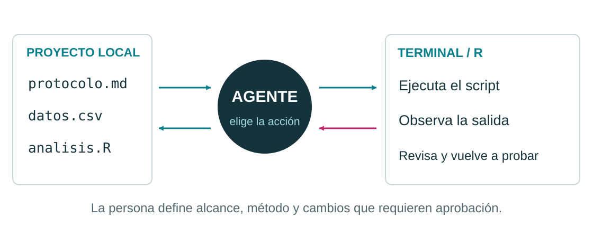

:::

::: {#agente-operando-takeaway bento-slot="takeaway"}

Se reduce el intercambio manual; no desaparece la supervisión.

:::

::: {#agente-operando-citation bento-slot="citation"}

Esquema didáctico; no resultado de una investigación.

:::

::: {#agente-operando-notas .notes}
Mostrar el ciclo archivos, ejecución, observación y corrección. El agente puede inspeccionar el directorio, ejecutar R, leer el mensaje, modificar el script y volver a probar, según permisos. Puede mantener una tarea durante varias iteraciones, no de forma ilimitada ni infalible. La persona decide alcance, metodología y qué cambios requieren aprobación.
:::

## Human Gates: puntos de revisión {#caso-ejecucion bento-variant="visual"}

::: {#caso-ejecucion-kicker bento-slot="kicker"}

03 / DEL CHAT AL AGENTE

:::

::: {#caso-ejecucion-visual bento-slot="visual"}

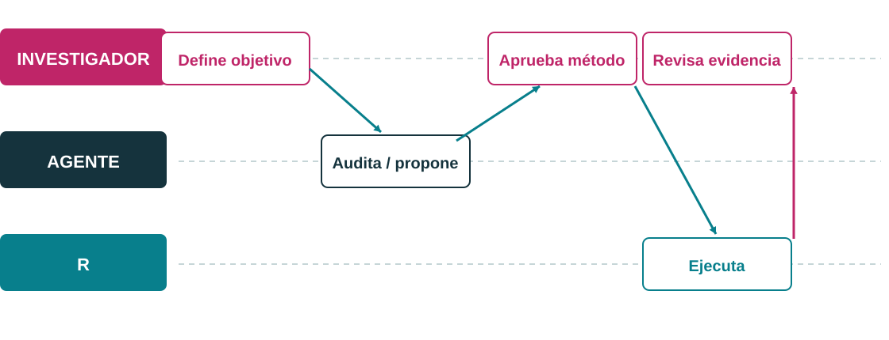

:::

::: {#caso-ejecucion-takeaway bento-slot="takeaway"}

Antes del método, ante cambios sustantivos y antes de interpretar.

:::

::: {#caso-ejecucion-citation bento-slot="citation"}

Esquema didáctico · no son resultados observados.

:::

::: {#caso-ejecucion-notas .notes}
Definir Human Gates como puntos de decisión y revisión humana. Antes: confirmar pregunta, datos, hipótesis y procedimiento. Durante: detenerse ante recodificación ambigua, cambio de modelo o supuesto. Después: revisar código, diagnósticos e interpretación. No pedir autorización para cada comando inocuo; definir autonomía proporcional. Una línea ejecutada correctamente no resuelve una decisión científica.
:::

## El problema que sigue abierto {#legibilidad-pendiente bento-variant="question"}

::: {#legibilidad-pendiente-kicker bento-slot="kicker"}

04 / CÓDIGO PARA INVESTIGAR

:::

::: {#legibilidad-pendiente-question bento-slot="question"}

El agente ya lo ejecutó. ¿Puedes modificar el análisis tú?

:::

::: {#legibilidad-pendiente-prompt bento-slot="prompt"}

Piensa en cambiar un solo modelo, una recodificación o un gráfico.

:::

::: {#legibilidad-pendiente-notas .notes}
La ganancia operativa no garantiza legibilidad. Dar paso al problema de código orientado a un entorno distinto del nuestro. Evitar afirmar que todos los LLM están entrenados para priorizar pipelines; lo que se discute es un patrón de salida posible que queremos encauzar.
:::

## Un cambio pequeño, demasiados lugares {#safe-cfa-mapa bento-variant="visual"}

::: {#safe-cfa-mapa-kicker bento-slot="kicker"}

04 / CÓDIGO PARA INVESTIGAR

:::

::: {#safe-cfa-mapa-visual bento-slot="visual"}

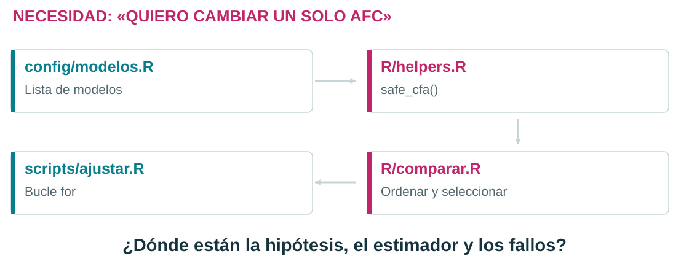

:::

::: {#safe-cfa-mapa-takeaway bento-slot="takeaway"}

La organización debe facilitar la siguiente decisión del investigador.

:::

::: {#safe-cfa-mapa-citation bento-slot="citation"}

Antiejemplo de arquitectura analítica, ficticio; no se ejecutaron estos modelos.

:::

::: {#safe-cfa-mapa-notas .notes}
Proyecto ficticio con modelos definidos en configuración, función safe_cfa en helpers, un bucle en otro script y clasificación de resultados aparte. Pregunta: dónde cambiar un único AFC y revisar lo que ocurrió. La división en scripts no es por sí misma un defecto; el problema es dispersar decisiones que se modifican juntas y dificultar la inspección del investigador.
:::

## Qué puede esconder una función auxiliar {#safe-cfa-detalle bento-variant="comparison"}

::: {#safe-cfa-detalle-kicker bento-slot="kicker"}

04 / CÓDIGO PARA INVESTIGAR

:::

::: {#safe-cfa-detalle-left-label bento-slot="left-label"}

Una envoltura demasiado silenciosa

:::

::: {#safe-cfa-detalle-left bento-slot="left" .bento-code}

```{#safe-cfa-detalle-left-source .r}
safe_cfa <- function(modelo, datos) {
  tryCatch(
    suppressWarnings(
      lavaan::cfa(modelo, data = datos)
    ),
    error = function(e) NULL
  )
}
```

:::

::: {#safe-cfa-detalle-right-label bento-slot="right-label"}

Comparación mecánica de modelos

:::

::: {#safe-cfa-detalle-right bento-slot="right" .bento-code}

```{#safe-cfa-detalle-right-source .r}
for (nombre in names(modelos)) {
  ajustes[[nombre]] <- safe_cfa(
    modelos[[nombre]], datos
  )
}

# ¿Dónde revisas estimador y fallos?
```

:::

::: {#safe-cfa-detalle-takeaway bento-slot="takeaway"}

Ejecutar muchos modelos no equivale a contrastar hipótesis justificadas.

:::

::: {#safe-cfa-detalle-citation bento-slot="citation"}

Antiejemplo ficticio y no ejecutado. El problema no es usar funciones: es ocultar decisiones.

:::

::: {#safe-cfa-detalle-notas .notes}
safe_cfa es un nombre ficticio, no una función de lavaan. En este antiejemplo, warnings y fallos dejan de ser visibles. La envoltura también puede ocultar argumentos y decisiones. Ni for ni las funciones auxiliares son incorrectos en general: se cuestiona que escondan las decisiones del estudio. No recomendar este código ni atribuirlo al entrenamiento universal de los LLM.
:::

## Un AFC que podamos revisar y modificar {#modelo-editable bento-variant="wide"}

::: {#modelo-editable-kicker bento-slot="kicker"}

04 / CÓDIGO PARA INVESTIGAR

:::

::: {#modelo-editable-visual bento-slot="visual" .bento-code}

```{#modelo-editable-visual-source .r}
modelo <- '
  planificacion =~ i01 + i02 + i03 + i04 + i05 + i06
  persistencia  =~ i07 + i08 + i09 + i10 + i11 + i12
'

ajuste <- lavaan::cfa(
  modelo, data = datos, ordered = items, estimator = "WLSMV"
)
summary(ajuste, fit.measures = TRUE, standardized = TRUE)
```

:::

::: {#modelo-editable-takeaway bento-slot="takeaway"}

Especificación, estimación e inspección juntas; las decisiones siguen siendo tuyas.

:::

::: {#modelo-editable-citation bento-slot="citation"}

Fuente: r-analytic-core / r-analytic-coding-principles; convención de trabajo del taller.

:::

::: {#modelo-editable-notas .notes}
El objeto es la organización del código, no enseñar AFC desde cero. Mostrar especificación, estimación y diagnóstico cerca. datos e items son entradas del estudio aún por definir: este fragmento es ilustrativo y no se ha ejecutado. WLSMV está escrito como decisión visible del ejemplo, no impuesto como regla general. Alterar una estructura factorial necesita justificación sustantiva, no solo editar una línea.
:::

## La preparación de datos también debe verse {#datos-visibles bento-variant="comparison"}

::: {#datos-visibles-kicker bento-slot="kicker"}

04 / CÓDIGO PARA INVESTIGAR

:::

::: {#datos-visibles-left-label bento-slot="left-label"}

Transformaciones escondidas

:::

::: {#datos-visibles-left bento-slot="left" .bento-code}

```{#datos-visibles-left-source .r}
source("R/preparacion.R")
datos <- clean_data(ruta)

# ¿Qué códigos cambió?
# ¿Qué ítems invirtió?
# ¿Qué casos excluyó?
```

:::

::: {#datos-visibles-right-label bento-slot="right-label"}

Reglas explícitas en el análisis

:::

::: {#datos-visibles-right bento-slot="right" .bento-code}

```{#datos-visibles-right-source .r}
datos <- readr::read_csv(
  "data/escala.csv", na = "NS"
)
datos <- datos |>
  dplyr::mutate(i03 = 5 - i03)
```

:::

::: {#datos-visibles-takeaway bento-slot="takeaway"}

Lo que cambia el significado de los datos debe poder localizarse.

:::

::: {#datos-visibles-citation bento-slot="citation"}

Ilustración de organización; requiere diccionario y clave. No se ejecutó sobre una base real.

:::

::: {#datos-visibles-notas .notes}
Ejemplo ficticio: el diccionario define NS como perdido y la clave define i03 como inverso en respuestas de 1 a 4. No inferir estas reglas de las correlaciones. clean_data es una función inventada de contenido no mostrado, no se afirma equivalencia entre fragmentos. La derecha muestra dónde revisar la decisión. Las validaciones sustantivas y el registro de exclusiones se conservan.
:::

## Un error visible también informa {#errores-visibles bento-variant="comparison"}

::: {#errores-visibles-kicker bento-slot="kicker"}

04 / CÓDIGO PARA INVESTIGAR

:::

::: {#errores-visibles-left-label bento-slot="left-label"}

Continuar como si nada hubiera pasado

:::

::: {#errores-visibles-left bento-slot="left" .bento-code}

```{#errores-visibles-left-source .r}
datos <- tryCatch(
  readr::read_csv(ruta),
  error = function(e) tibble::tibble()
)
# Falla la lectura, pero devuelve
# una tabla vacía.
```

:::

::: {#errores-visibles-right-label bento-slot="right-label"}

Diagnosticar el problema concreto

:::

::: {#errores-visibles-right bento-slot="right"}

Leer con una llamada ordinaria.  
Inspeccionar el error de ruta o paquete.  
Corregir su causa en el entorno.  
Conservar las comprobaciones del estudio.

:::

::: {#errores-visibles-takeaway bento-slot="takeaway"}

Controles proporcionados; diagnósticos visibles; sin errores maquillados.

:::

::: {#errores-visibles-citation bento-slot="citation"}

Fuente: r-analytic-core / r-analytic-coding-principles; convención de trabajo del taller.

:::

::: {#errores-visibles-notas .notes}
No enseñar a retirar todos los controles: distinguir un fallo de lectura real de una rutina genérica que lo silencia. El agente puede inspeccionar archivos y mensajes en vez de añadir manejadores para cada escenario imaginable. Los riesgos silenciosos concretos, por ejemplo una unión muchos-a-muchos inesperada, sí pueden requerir controles persistentes.
:::

## El estilo depende del trabajo {#estilos-de-trabajo bento-variant="visual"}

::: {#estilos-de-trabajo-kicker bento-slot="kicker"}

04 / CÓDIGO PARA INVESTIGAR

:::

::: {#estilos-de-trabajo-visual bento-slot="visual"}

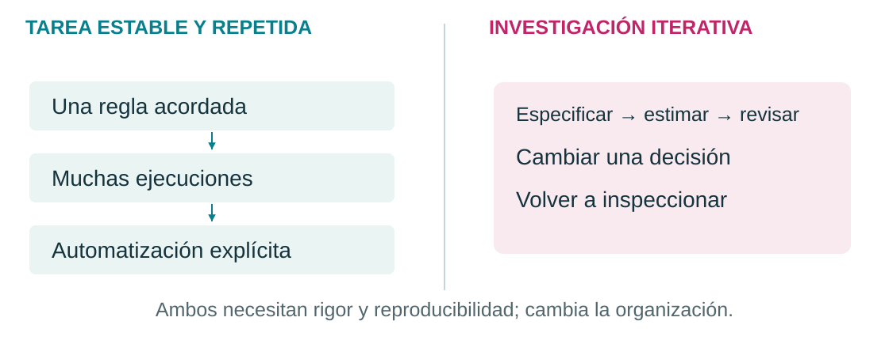

:::

::: {#estilos-de-trabajo-takeaway bento-slot="takeaway"}

Automatizar mecánica estable; mantener editables las decisiones que evolucionan.

:::

::: {#estilos-de-trabajo-citation bento-slot="citation"}

Fuente: r-analytic-core / r-analytic-coding-principles; convención de trabajo del taller.

:::

::: {#estilos-de-trabajo-notas .notes}
Contrastar una tarea estable y repetitiva con una investigación iterativa en la que se revisa cada modelo. Funciones, bucles y pipelines pueden ser apropiados en simulaciones o procesos acordados; el taller no contrapone reproducibilidad y legibilidad. Un modelo generalista puede proponer un estilo que no coincide con nuestras prioridades. Presentarlo como riesgo observable, no como afirmación no comprobada sobre todo su entrenamiento.
:::

## Lo que rodea al agente {#ecosistema-agente bento-variant="visual"}

::: {#ecosistema-agente-kicker bento-slot="kicker"}

05 / CONTEXTO E INSTRUCCIONES

:::

::: {#ecosistema-agente-visual bento-slot="visual"}

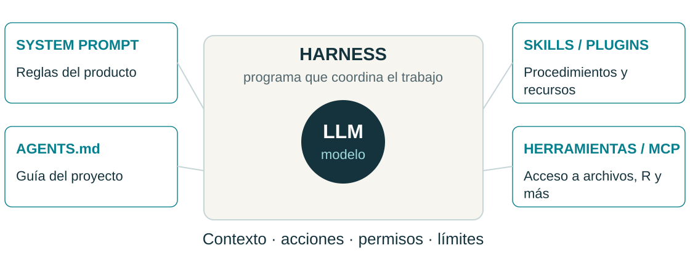

:::

::: {#ecosistema-agente-citation bento-slot="citation"}

Síntesis didáctica de documentación de agentes, AGENTS.md, Agent Skills y MCP.

:::

::: {#ecosistema-agente-notas .notes}
Dar un solo mapa. Harness: programa que organiza el ciclo, el contexto, herramientas y permisos. System prompt: reglas iniciales del producto o implementación. AGENTS.md: guía persistente del proyecto en agentes compatibles. Skills: procedimientos y recursos reutilizables. Plugins: una vía de empaquetarlos junto con herramientas. MCP: conexión con herramientas. No son sinónimos ni todos se configuran del mismo modo.
:::

## Nuestro foco: contexto y forma de trabajar {#ecosistema-foco bento-variant="visual"}

::: {#ecosistema-foco-kicker bento-slot="kicker"}

05 / CONTEXTO E INSTRUCCIONES

:::

::: {#ecosistema-foco-visual bento-slot="visual"}

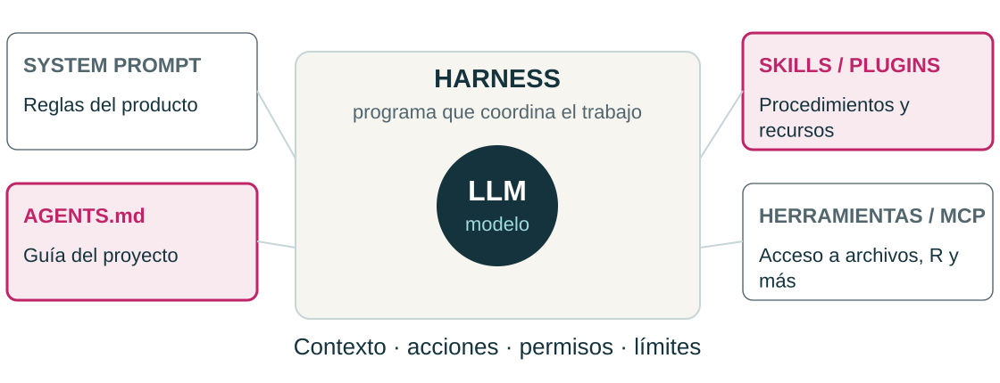

:::

::: {#ecosistema-foco-takeaway bento-slot="takeaway"}

El proyecto explica qué investigamos; las instrucciones orientan cómo trabajamos.

:::

::: {#ecosistema-foco-citation bento-slot="citation"}

Esquema didáctico; no resultado de una investigación.

:::

::: {#ecosistema-foco-notas .notes}
Repetir el mismo mapa, destacando únicamente AGENTS.md y skills. No redibujar todo ni sumar definiciones. Ambas responden a lo que acabamos de observar: el agente necesita contexto del estudio y un procedimiento de trabajo orientado a investigación. MCP y el harness se utilizarán después al montar Positron.
:::

## Como un analista que llega al equipo {#onboarding bento-variant="visual"}

::: {#onboarding-kicker bento-slot="kicker"}

05 / CONTEXTO E INSTRUCCIONES

:::

::: {#onboarding-visual bento-slot="visual"}


:::

::: {#onboarding-takeaway bento-slot="takeaway"}

Conocer estadística no equivale a conocer tu estudio.

:::

::: {#onboarding-citation bento-slot="citation"}

Esquema didáctico · no son resultados observados.

:::

::: {#onboarding-notas .notes}
Conectar la analogía con el mapa anterior, sin iniciar otro bloque de definiciones. El analista necesita objetivos, diseño, datos y normas. El LLM puede tener conocimiento general, pero no sabe qué se acordó en este estudio ni cómo queremos revisar los modelos.
:::

## Proyecto, guía y procedimientos {#documentos bento-variant="visual"}

::: {#documentos-kicker bento-slot="kicker"}

05 / CONTEXTO E INSTRUCCIONES

:::

::: {#documentos-visual bento-slot="visual"}

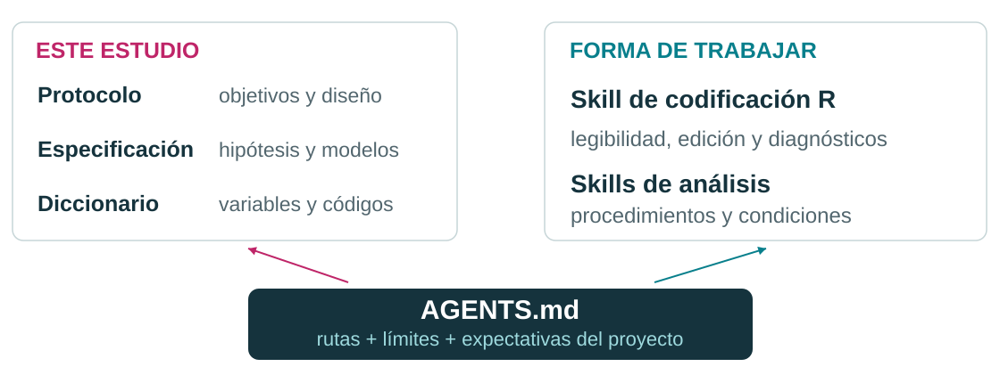

:::

::: {#documentos-takeaway bento-slot="takeaway"}

Una fuente para cada decisión; las demás instrucciones la enlazan.

:::

::: {#documentos-citation bento-slot="citation"}

Convención AGENTS.md + plantilla docente en materiales/plantilla-proyecto/.

:::

::: {#documentos-notas .notes}
Explicar en conjunto: protocolo y especificación para objetivos, diseño e hipótesis; diccionario para variables; AGENTS.md para rutas, restricciones y expectativas persistentes; skills para estilo y procedimientos reutilizables. AGENTS.md puede contener normas cortas de estilo si basta; una skill resulta útil si el contenido es largo, especializado o se reutiliza. No exigir fragmentación artificial ni duplicar todo en ambos.
:::

## AGENTS.md y la skill trabajando juntos {#agents-md bento-variant="comparison"}

::: {#agents-md-kicker bento-slot="kicker"}

05 / CONTEXTO E INSTRUCCIONES

:::

::: {#agents-md-left-label bento-slot="left-label"}

Guía del proyecto

:::

::: {#agents-md-left bento-slot="left" .bento-code}

```{#agents-md-left-source .markdown}
# Antes de analizar
- Lee docs/protocolo.md.
- Consulta docs/diccionario.csv.
- Conserva los datos originales.
- Usa la skill de estilo R disponible.
- Consulta cambios metodológicos.
```

:::

::: {#agents-md-right-label bento-slot="right-label"}

Procedimiento reutilizable

:::

::: {#agents-md-right bento-slot="right"}

La skill desarrolla el estilo de código,  
las comprobaciones y sus límites.  
El protocolo decide el método del estudio.  
AGENTS.md no sustituye ese protocolo.

:::

::: {#agents-md-takeaway bento-slot="takeaway"}

No duplicar la guía entera de R en cada proyecto.

:::

::: {#agents-md-citation bento-slot="citation"}

Ejemplo docente · AGENTS.md no es un protocolo científico ni un mecanismo de seguridad.

:::

::: {#agents-md-notas .notes}
Este archivo es un ejemplo de coordinación, no una invocación garantizada. r-analytic-coding-principles debe estar instalado y visible; su carga depende del agente. Otros productos pueden utilizar CLAUDE.md o GEMINI.md: el concepto es transferible, el nombre y prioridad se verifican. AGENTS.md no es sinónimo de system prompt ni un control de seguridad de ejecución.
:::

## La skill de codificación que utilizaremos {#skill-real bento-variant="wide"}

::: {#skill-real-kicker bento-slot="kicker"}

05 / CONTEXTO E INSTRUCCIONES

:::

::: {#skill-real-visual bento-slot="visual"}

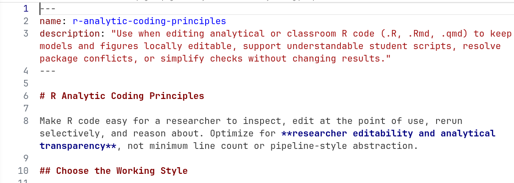

:::

::: {#skill-real-takeaway bento-slot="takeaway"}

Lee la finalidad, el alcance y los límites antes de utilizarla.

:::

::: {#skill-real-citation bento-slot="citation"}

Captura propia · r-analytic-core / r-analytic-coding-principles · consulta local 29-10-2026

:::

::: {#skill-real-notas .notes}
Captura propia del archivo r-analytic-core/r-analytic-coding-principles. Leer solo la finalidad: código que el investigador pueda inspeccionar, editar y retomar. Vincularlo con safe_cfa, lectura de datos y diagnósticos, no con una lista abstracta de buenas prácticas. No afirmar que ver el archivo prueba que un agente lo haya cargado.
:::

## Qué contiene y cuándo ayuda una skill {#skill-anatomia bento-variant="comparison"}

::: {#skill-anatomia-kicker bento-slot="kicker"}

05 / CONTEXTO E INSTRUCCIONES

:::

::: {#skill-anatomia-left-label bento-slot="left-label"}

Cuándo usarla

:::

::: {#skill-anatomia-left bento-slot="left"}

**Nombre y descripción:** activación y alcance.  
**Instrucciones:** cómo desarrollar la tarea.  
**Límites:** qué no debe decidir por nosotros.

:::

::: {#skill-anatomia-right-label bento-slot="right-label"}

Qué puede acompañarla

:::

::: {#skill-anatomia-right bento-slot="right"}

Referencias que se consultan al necesitarlas.  
Ejemplos y recursos de apoyo.  
Scripts opcionales que hay que revisar.  
No reentrena el modelo ni valida el resultado.

:::

::: {#skill-anatomia-takeaway bento-slot="takeaway"}

Reutilizar un procedimiento sin convertirlo en una regla ciega.

:::

::: {#skill-anatomia-citation bento-slot="citation"}

Agent Skills: formato SKILL.md; ejemplo real en r-workflow-plugins.

:::

::: {#skill-anatomia-notas .notes}
Mantener la explicación junto con AGENTS.md. La estructura puede incluir SKILL.md, referencias, scripts y assets. No toda skill trae código ejecutable. Las descripciones pueden facilitar descubrimiento; no garantizar activación automática ni portabilidad idéntica.
:::

## Las skills del taller {#skills-catalogo bento-variant="visual"}

::: {#skills-catalogo-kicker bento-slot="kicker"}

05 / CONTEXTO E INSTRUCCIONES

:::

::: {#skills-catalogo-visual bento-slot="visual"}

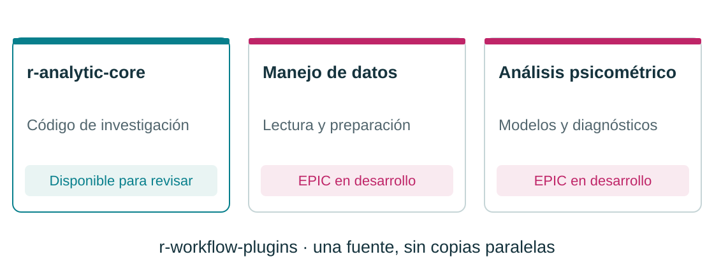

:::

::: {#skills-catalogo-takeaway bento-slot="takeaway"}

La misma fuente de skills; una versión comprobada para la demostración.

:::

::: {#skills-catalogo-citation bento-slot="citation"}

r-workflow-plugins: r-analytic-core disponible; módulos de datos y psicometría en desarrollo.

:::

::: {#skills-catalogo-notas .notes}
Mostrar r-analytic-core como base actualmente inspeccionable. Reservar dos espacios de alcance para datos y análisis psicométrico que se integrarán desde el EPIC; no inventar nombres definitivos ni versión publicada. No se crea una copia paralela de las skills en el taller. Al cerrar el EPIC, fijar versión, alcance y prueba con el caso.
:::

## ¿Dónde guardarías cada información? {#clasificar-actividad bento-variant="question"}

::: {#clasificar-actividad-kicker bento-slot="kicker"}

05 / CONTEXTO E INSTRUCCIONES

:::

::: {#clasificar-actividad-question bento-slot="question"}

«Dos factores propuestos»  
«Código R editable modelo por modelo»

:::

::: {#clasificar-actividad-prompt bento-slot="prompt"}

¿Qué pertenece al estudio y qué se puede reutilizar en otros proyectos?

:::

::: {#clasificar-actividad-notas .notes}
Actividad breve: hipótesis de estructura al protocolo o especificación; estilo R a una skill o guía reutilizable. La regla local puede enlazarla desde AGENTS.md. Aceptar soluciones de organización equivalentes siempre que no mezclen autoridad científica y procedimiento genérico.
:::

## La planificación proporcional {#plan-proporcional bento-variant="visual"}

::: {#plan-proporcional-kicker bento-slot="kicker"}

05 / CONTEXTO E INSTRUCCIONES

:::

::: {#plan-proporcional-visual bento-slot="visual"}

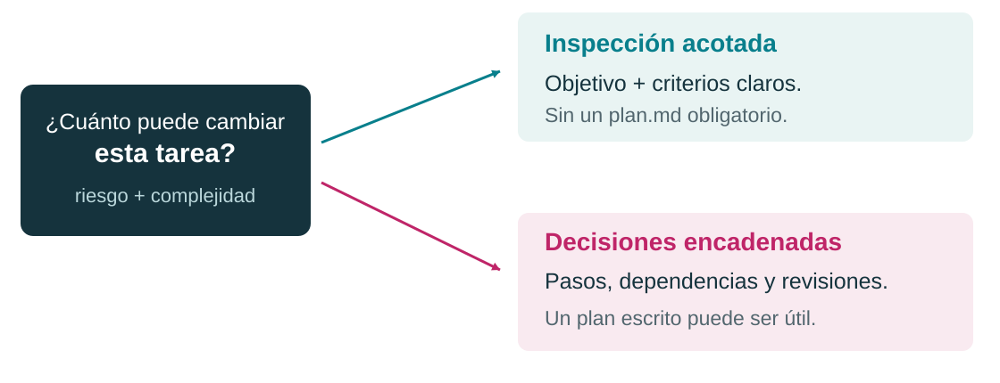

:::

::: {#plan-proporcional-takeaway bento-slot="takeaway"}

Planificar es explicitar decisiones; no producir archivos por reflejo.

:::

::: {#plan-proporcional-citation bento-slot="citation"}

Esquema didáctico · no son resultados observados.

:::

::: {#plan-proporcional-notas .notes}
Recordar la proporcionalidad: un encargo pequeño no necesita plan.md; sí objetivos, datos y criterios suficientes. Un estudio con varias fases puede necesitar planificación escrita. El nombre del archivo no sustituye pensar el diseño. Esta regla evita que la solución a la opacidad sea más burocracia.
:::

## Antes de adoptar una skill {#skills-confianza bento-variant="visual"}

::: {#skills-confianza-kicker bento-slot="kicker"}

05 / CONTEXTO E INSTRUCCIONES

:::

::: {#skills-confianza-visual bento-slot="visual"}

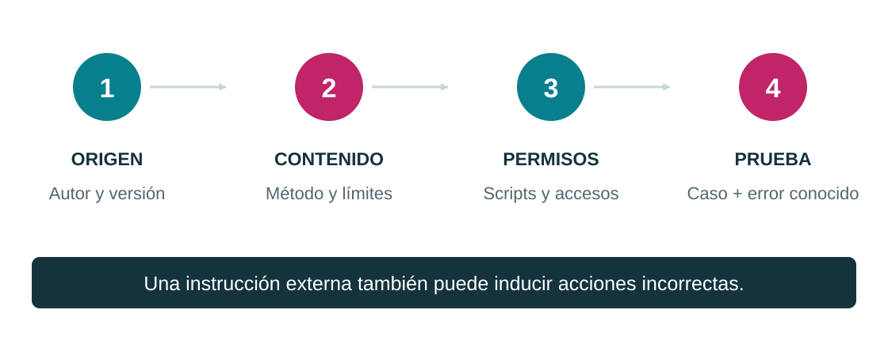

:::

::: {#skills-confianza-takeaway bento-slot="takeaway"}

Revisar también lo que la skill puede ejecutar.

:::

::: {#skills-confianza-citation bento-slot="citation"}

Esquema didáctico · no son resultados observados.

:::

::: {#skills-confianza-notas .notes}
Revisar procedencia, contenido, permisos y un caso de prueba. Una skill externa puede contener instrucciones equivocadas o scripts peligrosos. Mostrar que la guía de estilo no elimina diagnóstico ni aprobación humana. No instalar recursos desconocidos durante el taller.
:::

## Pausa {#descanso bento-variant="section"}

::: {#descanso-kicker bento-slot="kicker"}

DESCANSO · MINUTOS

:::

::: {#descanso-number bento-slot="number"}

10

:::

::: {#descanso-subtitle bento-slot="subtitle"}

Al volver: preparar el entorno y recorrer el caso en R.

:::

::: {#descanso-notas .notes}
Pausa prevista de diez minutos tras los fundamentos y las instrucciones. Es un punto de ajuste del ritmo, no un nuevo módulo.
:::

## Positron por dentro {#positron-entorno bento-variant="screenshot"}

::: {#positron-entorno-kicker bento-slot="kicker"}

06 / ENTORNO DE TRABAJO

:::

::: {#positron-entorno-visual bento-slot="visual"}

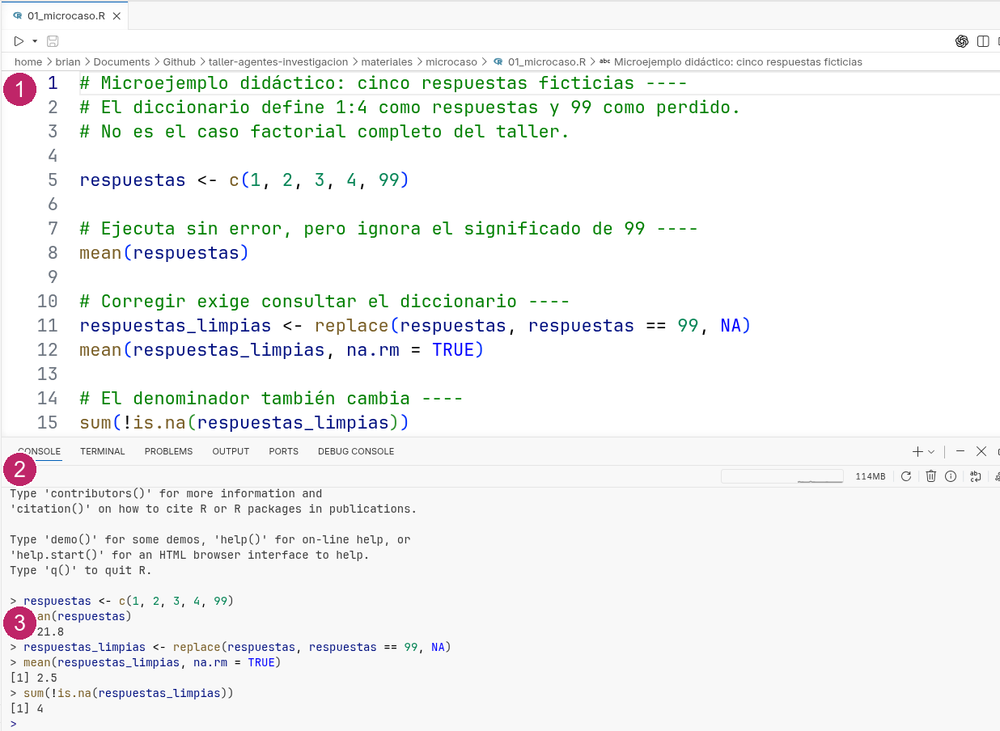

:::

::: {#positron-entorno-side1 bento-slot="side1"}

**1 · Script.** Instrucciones que podemos leer y modificar.

:::

::: {#positron-entorno-side2 bento-slot="side2"}

**2 · Consola R.** Lugar donde se ejecutan los cálculos.

:::

::: {#positron-entorno-side3 bento-slot="side3"}

**3 · Salida.** Evidencia que debe coincidir con lo reportado.

:::

::: {#positron-entorno-takeaway bento-slot="takeaway"}

No basta con la respuesta del chat: observa dónde se ejecuta.

:::

::: {#positron-entorno-citation bento-slot="citation"}

Captura propia · Positron 2026.10.2 · R 4.6.1 · microejemplo sintético.

:::

::: {#positron-entorno-notas .notes}
Ahora que sabemos qué exigimos al código y al contexto, presentar Positron como entorno de trabajo. Localizar script, consola y salida en una captura propia. La captura usa un ejemplo sintético, no un agente: no fingir conexión. El archivo sigue siendo el entregable, aunque exploremos en una sesión persistente.
:::

## Una herramienta para practicar {#opciones-agentes bento-variant="summary"}

::: {#opciones-agentes-kicker bento-slot="kicker"}

06 / ENTORNO DE TRABAJO

:::

::: {#opciones-agentes-first bento-slot="first"}

Agente externo: Codex, Claude Code o Gemini CLI.

:::

::: {#opciones-agentes-second bento-slot="second"}

Positron + MCP conecta al agente con la sesión de R.

:::

::: {#opciones-agentes-third bento-slot="third"}

Alternativa integrada: Posit Assistant en Positron o RStudio.

:::

::: {#opciones-agentes-fourth bento-slot="fourth"}

Elegimos una vía y verificamos permisos, contexto y resultados.

:::

::: {#opciones-agentes-citation bento-slot="citation"}

Fuentes oficiales de OpenAI, Anthropic, Google y Posit; consultadas el 29-10-2026.

:::

::: {#opciones-agentes-notas .notes}
Mostrar las opciones después del método. No exigir cuatro instalaciones ni comparar precios. Una misma familia de modelos puede participar en varias interfaces. Verificar compatibilidad real de skills, instrucciones y MCP en el agente elegido.
:::

## MCP: el puente hacia R {#positron-mcp bento-variant="visual"}

::: {#positron-mcp-kicker bento-slot="kicker"}

06 / ENTORNO DE TRABAJO

:::

::: {#positron-mcp-visual bento-slot="visual"}


:::

::: {#positron-mcp-takeaway bento-slot="takeaway"}

Sesión compartida para explorar; archivos para reproducir.

:::

::: {#positron-mcp-citation bento-slot="citation"}

Posit: October Release Highlights, 13-10-2026. Funcionalidad experimental.

:::

::: {#positron-mcp-notas .notes}
Definir MCP como protocolo de conexión, no como un modelo ni una skill. La integración experimental de Positron 2026.10 permite listar sesiones, ejecutar código e inspeccionar resultados. El proceso de configuración se muestra inmediatamente después. No prometer compatibilidad universal.
:::

## Conectar el agente a Positron {#positron-configurar bento-variant="comparison"}

::: {#positron-configurar-kicker bento-slot="kicker"}

06 / ENTORNO DE TRABAJO

:::

::: {#positron-configurar-left-label bento-slot="left-label"}

1 · Activar el servidor

:::

::: {#positron-configurar-left bento-slot="left"}

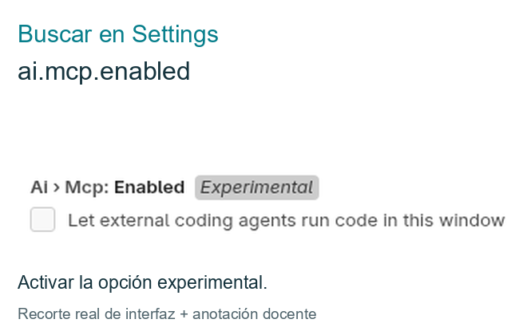

:::

::: {#positron-configurar-right-label bento-slot="right-label"}

2 · Añadir el cliente

:::

::: {#positron-configurar-right bento-slot="right"}

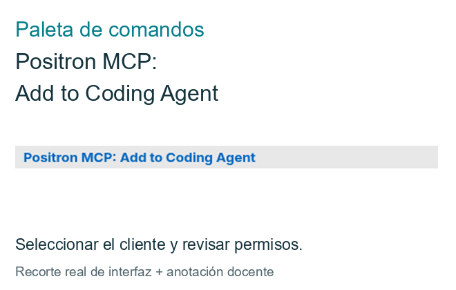

:::

::: {#positron-configurar-takeaway bento-slot="takeaway"}

Configuración local y permisos acotados; nunca proyectar credenciales.

:::

::: {#positron-configurar-citation bento-slot="citation"}

Posit, notas 2026.10; capturas propias de interfaz. Función experimental.

:::

::: {#positron-configurar-notas .notes}
Abrir proyecto e iniciar una sesión R. En Settings buscar ai.mcp.enabled y activarlo. Después usar Positron MCP: Add to Coding Agent para Codex o Gemini CLI; la nota oficial describe configuración automática para Claude Code. Otros clientes requieren Copy Connection Details. No proyectar URL con token, claves API ni archivos de credenciales. Las capturas muestran el ajuste y el comando, no una conexión completada. Consultar la guía de herramientas para pasos y alcance.
:::

## Comprobar la conexión, no solo activarla {#mcp-prueba bento-variant="comparison"}

::: {#mcp-prueba-kicker bento-slot="kicker"}

06 / ENTORNO DE TRABAJO

:::

::: {#mcp-prueba-left-label bento-slot="left-label"}

Pedido de comprobación

:::

::: {#mcp-prueba-left bento-slot="left" .bento-code}

```{#mcp-prueba-left-source .text}
Lista las sesiones disponibles.
Identifica la sesión R del taller.
Ejecuta sum(1:4) en esa sesión.
Muestra la salida y no modifiques
archivos ni configuraciones.
```

:::

::: {#mcp-prueba-right-label bento-slot="right-label"}

Qué debemos observar

:::

::: {#mcp-prueba-right bento-slot="right"}

La sesión correcta.  
La llamada a la herramienta.  
El código y el nombre del agente.  
La salida 10 en la consola R.

:::

::: {#mcp-prueba-takeaway bento-slot="takeaway"}

Una respuesta correcta no basta: importa dónde y cómo se obtuvo.

:::

::: {#mcp-prueba-citation bento-slot="citation"}

Prueba propuesta de conexión; no es evidencia de una conexión ya realizada.

:::

::: {#mcp-prueba-notas .notes}
Prueba a realizar con el cliente definitivo; no afirmar que ya se ejecutó vía MCP. sum(1:4) vale 10, pero obtener 10 en un chat no prueba acceso a esa sesión: debe observarse la llamada y su procedencia en Positron. Inspeccionar alcance de archivos y directorio de trabajo antes del caso. El kit incluye una lista de comprobación.
:::

## Una ejecución visible desde el agente {#mcp-captura bento-variant="screenshot"}

::: {#mcp-captura-kicker bento-slot="kicker"}

06 / ENTORNO DE TRABAJO

:::

::: {#mcp-captura-visual bento-slot="visual"}

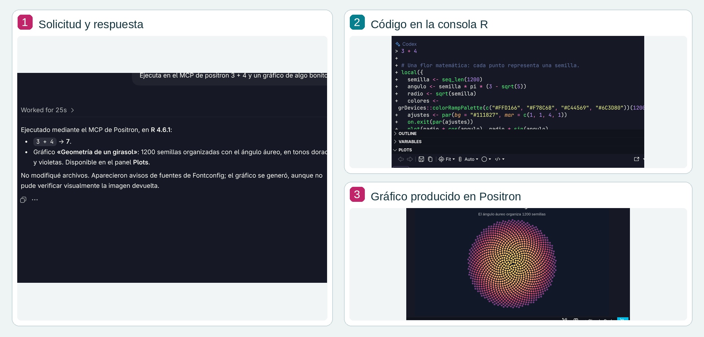

:::

::: {#mcp-captura-side1 bento-slot="side1"}

**1 · Solicitud.** Codex recibe el encargo de calcular y dibujar.

:::

::: {#mcp-captura-side2 bento-slot="side2"}

**2 · Ejecución.** La consola R identifica el código enviado por Codex.

:::

::: {#mcp-captura-side3 bento-slot="side3"}

**3 · Resultado.** La consola muestra 3 + 4 y aparece el gráfico.

:::

::: {#mcp-captura-takeaway bento-slot="takeaway"}

La ejecución y sus resultados dejan rastros que podemos inspeccionar.

:::

::: {#mcp-captura-citation bento-slot="citation"}

Captura propia (29-10-2026), remaquetada; original local y procedencia documentada.

:::

::: {#mcp-captura-notas .notes}
Captura propia proporcionada por el autor: se observa un encargo de Codex para calcular 3 + 4 y generar un gráfico; la respuesta declara ejecución mediante MCP, la consola R identifica Codex y aparece la figura de un girasol. Son tres recortes del mismo original, sin el avatar ni controles personales. No presenta un log de transporte MCP completo, por lo que no usarla como certificación independiente. La prueba anterior de sum(1:4) es otro encargo sugerido, no el cálculo mostrado aquí.
:::

## Posit Assistant: otra forma de entrar {#posit-assistant bento-variant="screenshot"}

::: {#posit-assistant-kicker bento-slot="kicker"}

06 / ENTORNO DE TRABAJO

:::

::: {#posit-assistant-visual bento-slot="visual"}


:::

::: {#posit-assistant-side1 bento-slot="side1"}

**Pedir.** Formular una tarea dentro del entorno.

:::

::: {#posit-assistant-side2 bento-slot="side2"}

**Inspeccionar.** Observar las instrucciones y herramientas utilizadas.

:::

::: {#posit-assistant-side3 bento-slot="side3"}

**Comprobar.** Revisar el objeto abierto y el resultado.

:::

::: {#posit-assistant-takeaway bento-slot="takeaway"}

Un proveedor configurado; ningún secreto en las diapositivas.

:::

::: {#posit-assistant-citation bento-slot="citation"}

Posit (13-10-2026) · captura oficial de producto · fuente y original en assets/screenshots/

:::

::: {#posit-assistant-notas .notes}
Alternativa integrada a un agente externo. Mostrar petición, acceso a herramientas y revisión en la captura oficial. Requiere un proveedor compatible configurado; el acceso y las credenciales se resuelven fuera de la proyección. Evitar duplicar una instalación si ya se eligió la vía externa.
:::

## De una carpeta recibida al análisis {#caso-portada bento-variant="section"}

::: {#caso-portada-kicker bento-slot="kicker"}

07 / PRÁCTICA PSICOMÉTRICA

:::

::: {#caso-portada-number bento-slot="number"}

07

:::

::: {#caso-portada-subtitle bento-slot="subtitle"}

Comprender el encargo, organizar el proyecto y construir un análisis que podamos revisar.

:::

::: {#caso-portada-notas .notes}

Abrir una copia extraída del ZIP fuera del repositorio docente. El punto de partida contiene seis archivos, sin AGENTS.md, scripts ni resultados. El grupo debe construir esa organización durante la práctica. Los datos completos ya están simulados y comprobados en una referencia docente separada; no precargarla en el agente. Mantener visible la aprobación humana antes de reorganizar o modelar.

:::

## La carpeta que recibimos {#caso-diseno bento-variant="visual"}

::: {#caso-diseno-kicker bento-slot="kicker"}

07 / PRÁCTICA PSICOMÉTRICA

:::

::: {#caso-diseno-visual bento-slot="visual"}

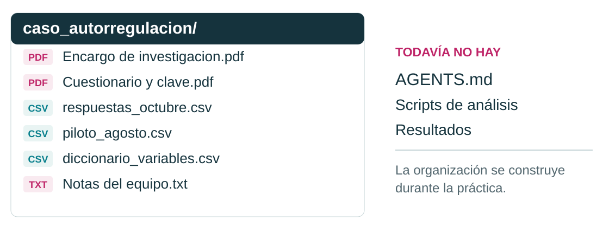

:::

::: {#caso-diseno-takeaway bento-slot="takeaway"}

Primero leer y comprender; todavía no reorganizar ni ejecutar modelos.

:::

::: {#caso-diseno-citation bento-slot="citation"}

Archivos reales del ejercicio · datos simulados · practica/caso_autorregulacion_inicio.zip

:::

::: {#caso-diseno-notas .notes}

Mostrar la carpeta extraída con los dos PDF, las dos bases, el diccionario y las notas. Pedir que el agente identifique objetivos, archivo principal y dudas sin modificar nada. No usar la raíz del repositorio porque contiene instrucciones y soluciones docentes. Verificar además instrucciones heredadas del cliente. El escenario contempla 500 participantes, doce ítems ordinales y dos dimensiones; no confundir filas exportadas con personas.

:::

## Antes del primer modelo {#caso-configurar bento-variant="visual"}

::: {#caso-configurar-kicker bento-slot="kicker"}

07 / PRÁCTICA PSICOMÉTRICA

:::

::: {#caso-configurar-visual bento-slot="visual"}

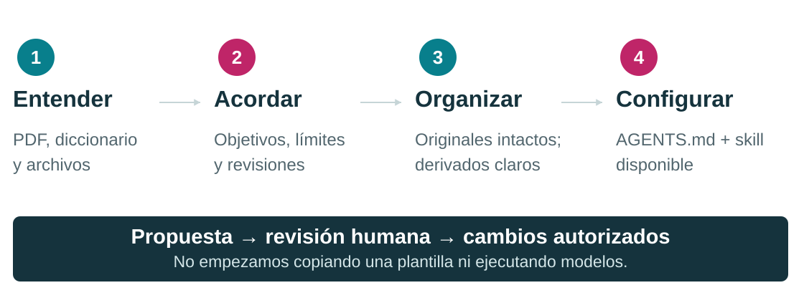

:::

::: {#caso-configurar-takeaway bento-slot="takeaway"}

La preparación del proyecto también forma parte del análisis.

:::

::: {#caso-configurar-citation bento-slot="citation"}

Guion de la actividad en docs/practica-guiada.md · sin configuración precargada en el ZIP.

:::

::: {#caso-configurar-notas .notes}
Después del inventario, pedir una propuesta de organización y de instrucciones estables. Separar qué va en AGENTS.md, qué se mantiene en los PDF o en un resumen científico y qué aporta la skill. Revisar antes de autorizar escritura. El agente puede proponer carpetas pero no hay un árbol obligatorio ni se exige plan.md. Solo entonces organizar una copia del trabajo, crear AGENTS.md y proceder con la auditoría y el método aprobado.
:::

## El encargo para la demostración {#caso-prompt bento-variant="comparison"}

::: {#caso-prompt-kicker bento-slot="kicker"}

07 / PRÁCTICA PSICOMÉTRICA

:::

::: {#caso-prompt-left-label bento-slot="left-label"}

Primero: entender la carpeta recibida

:::

::: {#caso-prompt-left bento-slot="left" .bento-code}

```{#caso-prompt-left-source .text}
Lee el encargo PDF y las notas.
Revisa cuestionario y diccionario.
Distingue estudio principal y piloto.
Resume objetivos y dudas.
No cambies archivos todavía.
```

:::

::: {#caso-prompt-right-label bento-slot="right-label"}

Después: acordar y construir

:::

::: {#caso-prompt-right bento-slot="right" .bento-code}

```{#caso-prompt-right-source .text}
Propón organización y AGENTS.md.
Espera mi revisión antes de escribir.
Organiza sin alterar originales.
Audita datos; propón el método.
Ejecuta tras aprobarlo y revisa.
```

:::

::: {#caso-prompt-takeaway bento-slot="takeaway"}

La tarea y los controles importan más que una formulación sofisticada.

:::

::: {#caso-prompt-citation bento-slot="citation"}

Texto docente · versión extendida en materiales/prompts-demostracion.md.

:::

::: {#caso-prompt-notas .notes}

No entregar un AGENTS.md prefabricado. Hacer explícito el paso de leer los insumos a proponer una forma de trabajo y obtener aprobación. Después de configurar, inspeccionar los datos con R y presentar decisiones metodológicas. La comparación con la solución docente es apoyo del facilitador, no información que reciba el agente al inicio. El método debe poder continuarse manualmente.

:::

## Antes de aceptar un cálculo {#promesa bento-variant="visual"}

::: {#promesa-kicker bento-slot="kicker"}

07 / PRÁCTICA PSICOMÉTRICA

:::

::: {#promesa-visual bento-slot="visual"}


:::

::: {#promesa-takeaway bento-slot="takeaway"}

¿Qué falta saber antes de aceptar el resultado?

:::

::: {#promesa-citation bento-slot="citation"}

Microejemplo ficticio · R 4.6.1 · materiales/microcaso/01_microcaso.R

:::

::: {#promesa-notas .notes}
Ahora, dentro de la práctica, mostrar las cinco respuestas ficticias. Pedir qué significa 99 y qué documento lo decide. No se usa esta pregunta para abrir el taller, sino para ejercitar la revisión ya aprendida.
:::

## Una ejecución sin errores {#micro-ejecucion bento-variant="visual"}

::: {#micro-ejecucion-kicker bento-slot="kicker"}

07 / PRÁCTICA PSICOMÉTRICA

:::

::: {#micro-ejecucion-visual bento-slot="visual"}

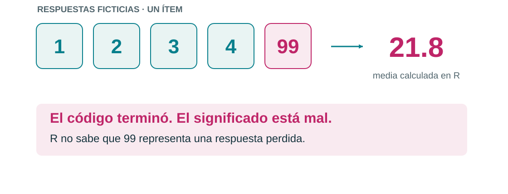

:::

::: {#micro-ejecucion-takeaway bento-slot="takeaway"}

El código funciona; el análisis puede seguir estando mal.

:::

::: {#micro-ejecucion-citation bento-slot="citation"}

Microejemplo ficticio · R 4.6.1 · materiales/microcaso/01_microcaso.R

:::

::: {#micro-ejecucion-notas .notes}
Salida real de R para el microejemplo: mean de 1,2,3,4,99 es 21.8. El error didáctico es semántico, no computacional. No atribuirlo a un agente concreto. Buscar el diccionario antes de corregir.
:::

## La corrección documentada {#caso-correccion bento-variant="visual"}

::: {#caso-correccion-kicker bento-slot="kicker"}

07 / PRÁCTICA PSICOMÉTRICA

:::

::: {#caso-correccion-visual bento-slot="visual"}


:::

::: {#caso-correccion-takeaway bento-slot="takeaway"}

La corrección debe quedar en código y conservar el original.

:::

::: {#caso-correccion-citation bento-slot="citation"}

Microejemplo ficticio · R 4.6.1 · materiales/microcaso/01_microcaso.R

:::

::: {#caso-correccion-notas .notes}
El diccionario del microejemplo define 99 como perdido. La recodificación explícita produce media 2.5 con cuatro observaciones válidas. Mostrar código y denominador, conservar los originales y vincular la corrección con el criterio humano. No confundir este ejemplo con un análisis de fiabilidad.
:::

## La salida real de R {#r-salida-real bento-variant="wide"}

::: {#r-salida-real-kicker bento-slot="kicker"}

07 / PRÁCTICA PSICOMÉTRICA

:::

::: {#r-salida-real-visual bento-slot="visual"}

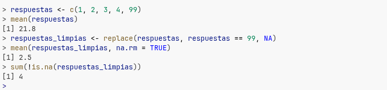

:::

::: {#r-salida-real-takeaway bento-slot="takeaway"}

Los números del relato deben coincidir con la evidencia de ejecución.

:::

::: {#r-salida-real-citation bento-slot="citation"}

Captura propia de consola · salida comprobada también con Rscript --vanilla.

:::

::: {#r-salida-real-notas .notes}
Captura propia de la consola del microejemplo, también reproducida desde una sesión limpia de R. Verificar que aparecen 21.8, 2.5 y 4. La captura no prueba ejecución por un agente ni un ajuste factorial completo.
:::

## La estructura que vamos a contrastar {#modelo-propuesto bento-variant="visual"}

::: {#modelo-propuesto-kicker bento-slot="kicker"}

07 / PRÁCTICA PSICOMÉTRICA

:::

::: {#modelo-propuesto-visual bento-slot="visual"}

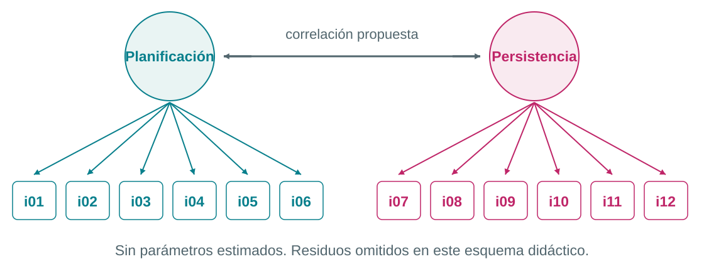

:::

::: {#modelo-propuesto-takeaway bento-slot="takeaway"}

El modelo expresa una hipótesis; no es un dibujo que el agente deba adivinar.

:::

::: {#modelo-propuesto-citation bento-slot="citation"}

Esquema del modelo propuesto · sin parámetros estimados ni evidencia empírica.

:::

::: {#modelo-propuesto-notas .notes}
Hipótesis de dos factores y doce indicadores. Residuos omitidos solo en el esquema. Contrastar con el código explícito mostrado antes: cambiar un ítem afecta una decisión sustantiva. Los coeficientes y diagnósticos del caso completo se incorporarán cuando se hayan ejecutado y verificado.
:::

## Después de la convergencia {#caso-diagnostico bento-variant="visual"}

::: {#caso-diagnostico-kicker bento-slot="kicker"}

07 / PRÁCTICA PSICOMÉTRICA

:::

::: {#caso-diagnostico-visual bento-slot="visual"}

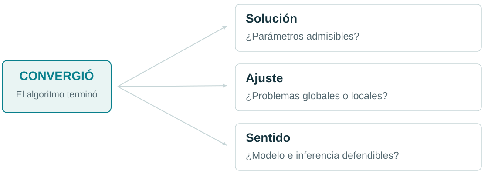

:::

::: {#caso-diagnostico-takeaway bento-slot="takeaway"}

Un algoritmo que termina todavía deja preguntas importantes.

:::

::: {#caso-diagnostico-citation bento-slot="citation"}

Esquema didáctico · no son resultados observados.

:::

::: {#caso-diagnostico-notas .notes}
Después de ejecutar un AFC no basta el mensaje de convergencia. Revisar admisibilidad, parámetros, ajuste local/global y coherencia sustantiva. No se muestran índices de ajuste fabricados. Identificar qué procedimiento realizará el agente y qué evaluación corresponde al investigador.
:::

## Volver a empezar desde los archivos {#caso-repro bento-variant="visual"}

::: {#caso-repro-kicker bento-slot="kicker"}

07 / PRÁCTICA PSICOMÉTRICA

:::

::: {#caso-repro-visual bento-slot="visual"}


:::

::: {#caso-repro-takeaway bento-slot="takeaway"}

Reproducir el cálculo también permite reproducir un error: todavía hay que interpretarlo.

:::

::: {#caso-repro-citation bento-slot="citation"}

Microejemplo ficticio · R 4.6.1 · materiales/microcaso/01_microcaso.R

:::

::: {#caso-repro-notas .notes}
Volver a ejecutar el script desde archivos en una sesión limpia. La sesión persistente ayuda a explorar, pero no debe crear dependencia de objetos invisibles. La reproducibilidad conserva también los errores, así que revisar significado y decisiones sigue siendo necesario.
:::

## Del resultado a la conclusión {#actividad-auditoria bento-variant="visual"}

::: {#actividad-auditoria-kicker bento-slot="kicker"}

07 / PRÁCTICA PSICOMÉTRICA

:::

::: {#actividad-auditoria-visual bento-slot="visual"}


:::

::: {#actividad-auditoria-takeaway bento-slot="takeaway"}

¿Qué parte de la afirmación está respaldada y cuál excede la evidencia?

:::

::: {#actividad-auditoria-citation bento-slot="citation"}

Esquema didáctico · no son resultados observados.

:::

::: {#actividad-auditoria-notas .notes}
Auditar la frase que infiere validez global solo del ajuste factorial. Es una afirmación ficticia para discutir, no un resultado del taller. Pedir datos, código, diagnósticos y delimitación de la inferencia. Recuperar los Human Gates antes de redactar conclusiones.
:::

## Lo que conservamos al delegar {#cuatro-ideas bento-variant="summary"}

::: {#cuatro-ideas-kicker bento-slot="kicker"}

CIERRE

:::

::: {#cuatro-ideas-first bento-slot="first"}

**La pregunta** y las decisiones metodológicas.

:::

::: {#cuatro-ideas-second bento-slot="second"}

**El código**, legible y modificable por nosotros.

:::

::: {#cuatro-ideas-third bento-slot="third"}

**La revisión**, en los puntos donde importa decidir.

:::

::: {#cuatro-ideas-fourth bento-slot="fourth"}

**La evidencia**, ejecutada y reproducible.

:::

::: {#cuatro-ideas-notas .notes}
Cerrar sin novedades. Contrastar el inicio con el recorrido: ya no solo se recibe código, se dirige un proceso que podemos revisar y continuar. No prometer productividad automática; la mejora depende del uso competente y del contexto.
:::

## Un proyecto para seguir practicando {#recursos bento-variant="comparison"}

::: {#recursos-kicker bento-slot="kicker"}

CIERRE

:::

::: {#recursos-left-label bento-slot="left-label"}

Punto de partida para la práctica

:::

::: {#recursos-left bento-slot="left" .bento-code}

```{#recursos-left-source .text}
practica/
  caso_autorregulacion_inicio.zip
  carpeta_recibida/

Solo datos y documentos del estudio.
```

:::

::: {#recursos-right-label bento-slot="right-label"}

Abrir una copia independiente

:::

::: {#recursos-right bento-slot="right" .bento-code}

```{#recursos-right-source .text}
Extrae el ZIP fuera del repositorio.
Abre la carpeta recibida en Positron.
Comprende, acuerda y configura.
No precargues soluciones docentes.
```

:::

::: {#recursos-takeaway bento-slot="takeaway"}

Practica el método antes de aumentar la complejidad.

:::

::: {#recursos-citation bento-slot="citation"}

Proyecto local del taller · fuentes, notas y scripts separados.

:::

::: {#recursos-notas .notes}

El recurso principal es el ZIP con seis insumos, sin scripts ni instrucciones de agentes. La carpeta docente guarda parámetros y comprobaciones y no debe distribuirse como punto de partida. El microejemplo y las guías generales siguen disponibles como apoyos, pero no deben resolver por anticipado la configuración del caso. Las skills definitivas siguen requiriendo ensayo con el agente elegido.

:::

## Fuentes de herramientas y formatos {#referencias-herramientas bento-variant="references"}

::: {#referencias-herramientas-kicker bento-slot="kicker"}

APOYO · REFERENCIAS

:::

::: {#referencias-herramientas-left bento-slot="left"}

**Positron / MCP**  
Posit, October Release Highlights (13-10-2026).  
**Posit Assistant**  
Getting Started y Providers.  
**R Core**  
Random Number Generation: set.seed / RNGversion.

:::

::: {#referencias-herramientas-right bento-slot="right"}

**AGENTS.md**  
Convención oficial: agents.md.  
**Agent Skills**  
Specification: agentskills.io.  
**Agentes de codificación**  
Documentación de Codex, Claude Code y Gemini CLI.

:::

::: {#referencias-herramientas-citation bento-slot="citation"}

Documentación oficial consultada el 29-10-2026.

:::

::: {#referencias-herramientas-notas .notes}
Fuentes oficiales y enlaces completos en docs/fuentes.md. Esta lámina es apoyo, no tiempo de exposición obligatorio. Se añadieron fuentes sobre harness y configuración de MCP; no usar citas de producto como prueba de productividad universal.
:::

## Fuentes y límites del material {#referencias-materiales bento-variant="references"}

::: {#referencias-materiales-kicker bento-slot="kicker"}

APOYO · REFERENCIAS

:::

::: {#referencias-materiales-left bento-slot="left"}

**Skill de R**  
r-workflow-plugins: r-analytic-coding-principles.  
**AFC y fiabilidad**  
lavaan: datos categóricos; semTools: compRelSEM.  
**Caso del taller**  
Datos simulados y referencia docente separada.

:::

::: {#referencias-materiales-right bento-slot="right"}

**Diagramas**  
Esquemas didácticos; no resultados empíricos.  
**Capturas**  
Propias en perfil aislado u oficiales de Posit, identificadas.  
**Caso completo**  
No se presentan índices de ajuste ni coeficientes no calculados.

:::

::: {#referencias-materiales-citation bento-slot="citation"}

Consultar docs/fuentes.md y assets/screenshots/provenance.json.

:::

::: {#referencias-materiales-notas .notes}

Distinguir esquemas y ejemplos ficticios de capturas y resultados ejecutados. La carpeta inicial sí tiene datos completos, PDF y diccionario; las comprobaciones en R se guardan por separado para el docente. La presentación no atribuye esos resultados a un agente ni muestra una activación de skills no comprobada. La documentación de lavaan y semTools respalda el uso de funciones, no la validez de un instrumento real.

:::
